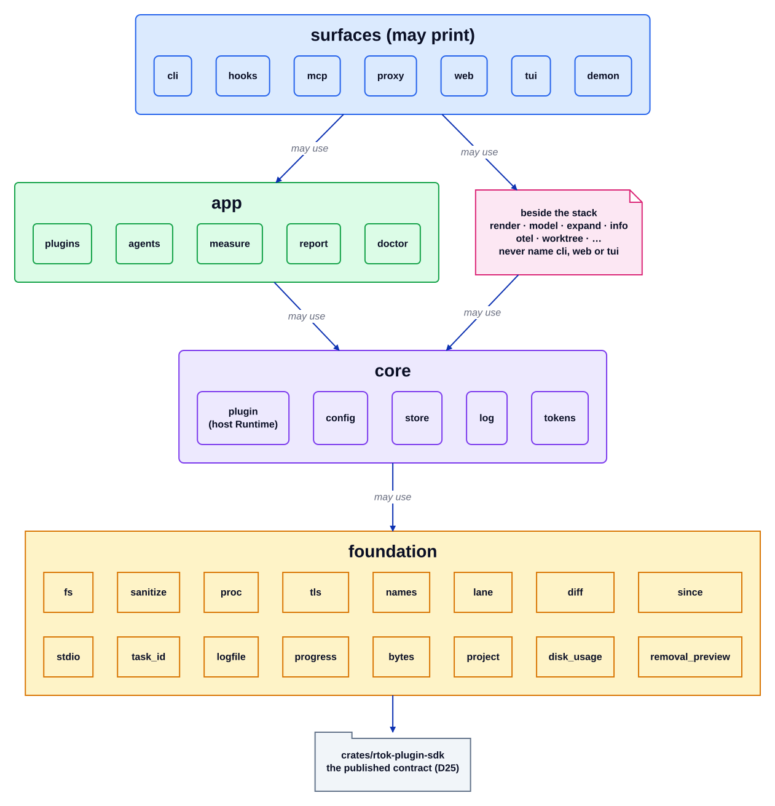

# Layers

Source: [`layers.d2`](layers.d2). Index: [all diagrams](README.md).

The modules under `src/` form a directed acyclic graph with four ranks. An edge may point
down or sideways, never up. `tests/module_graph.rs` reads every `crate::…` path in production code (test modules
stripped) and fails the build on a cycle or an upward edge, so the
picture cannot drift from the code.

## Walkthrough

1. **Surfaces** (`cli`, `hooks`, `mcp`, `proxy`, `web`, `tui`, `demon`) are the entry points.
   They are the only modules allowed to write the terminal: everyone else sends text through
   `stdio::stdout` / `stdio::stderr` and `cli::run` prints it (`clippy::print_stdout` and
   `print_stderr` are lint errors elsewhere under `-D warnings`). A surface may call another surface when that does not
   close a cycle (`cli` reaches `hooks`, `web` reaches `demon`).
2. **App** modules (`plugins`, `agents`, `measure`, `report`, `doctor`) hold the product
   logic: the plugin registry and every plugin, the host integrations, transcript ingest and
   the reports.
3. **Core** is the host runtime `plugin` plus `config`, `store`, `log` and `tokens`. The last
   four reference only core and foundation; `plugin` may also use `project` and does not use
   a surface or an app module.
4. **Foundation** modules are leaf helpers: paths and files, sanitising, processes, TLS, id
   prefixes, request lanes, diffs, time windows, the stdio sink and progress output.
5. **The SDK crate** `rtok-plugin-sdk` is the contract a plugin implements (D25). It depends
   on no workspace crate, so an out-of-tree plugin pulls in nothing else.
6. **Beside the stack** sit modules such as `render`, `model` (the D23 operator model),
   `expand`, `info`, `otel` and `worktree`. They may use the core but must not name `cli`,
   `web` or `tui`, and they do not print.

## Where it lives

| Box | Code |
| --- | --- |
| Rank lists and the DAG check | `tests/module_graph.rs` (`SURFACES`, `APP`, `CORE`, `FOUNDATION`) |
| Module declarations | `src/lib.rs` |
| Print lint | `Cargo.toml` `[lints.clippy]` (`print_stdout`, `print_stderr`), allowed per surface (`src/cli/mod.rs`) |
| Heavy-dependency ownership | `tests/deps.rs` |

## Invariants

- No cycle and no upward edge between production modules.
- Only surfaces print.
- `diesel` is named only by `rtok-store`, `rmcp` only by `src/mcp`, `ratatui` only by
  `src/tui/` (`tests/deps.rs`).

## Related

[Overview](overview.md) · [Crates](crates.md) · [Plugin contract](plugin-contract.md) ·
[`architecture.md` §2](../../architecture.md)
