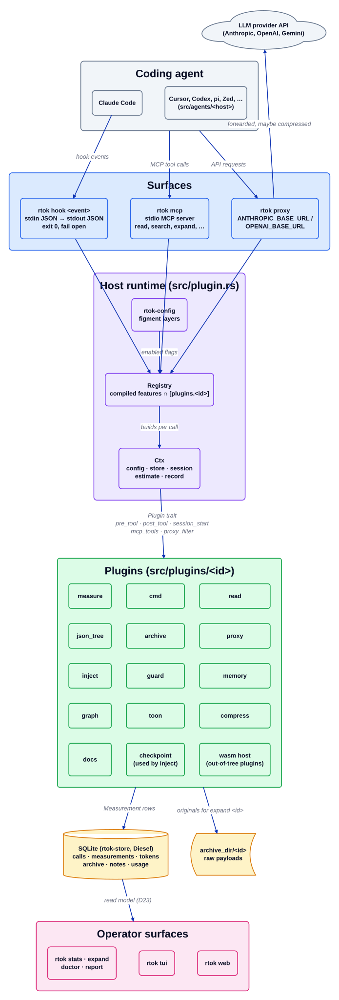

# Overview

Source: [`overview.d2`](overview.d2). Index of every diagram: [README](README.md).

rtok is one Rust binary. A coding agent reaches it through three surfaces; each surface
builds the same plugin registry, hands every enabled plugin a `Ctx`, and records what the
plugins did in one SQLite file. The operator surfaces only read that file.

## Walkthrough

1. **A coding agent calls in.** Claude Code runs `rtok hook <event>` for each hook event
   (installed by `rtok agents install claude`). A host can also start `rtok mcp` as an MCP
   server, and a host with a configurable API base URL can send its LLM traffic through
   `rtok proxy`. Each host's wiring lives in `src/agents/<host>/`.
2. **The surface builds a registry.** `Registry::new(&config)` takes every plugin compiled in
   (one Cargo feature per plugin id, `default = all`) and keeps the ones whose
   `[plugins.<id>] enabled` is true, falling back to `Manifest::default_on`.
3. **Plugins act through one trait.** The surface calls the trait method for its event:
   `pre_tool` (deny or rewrite a tool call), `post_tool` (add context only), `session_start` /
   `prompt_submit` (injections, budgeted by `inject`), `mcp_tools`, or `proxy_filter`. Every
   method has a no-op default, so a plugin implements only what its manifest declares.
4. **Shortening stays lossless.** A plugin that shortens output writes the original to
   `archive_dir/<id>` and leaves an `expand <id>` pointer in what the model sees.
5. **A saving is a row.** `Ctx::record` writes a `Measurement` (before and after tokens) to
   SQLite. A claim with no row does not exist.
6. **Operators read the ledger.** `rtok stats`, `rtok tui` and `rtok web` render the same read
   model (D23) over the store; none of them sits on the hook path.
7. **The proxy forwards.** `rtok proxy` records the request, lets `proxy_filter` plugins
   shorten tool results in it, forwards it upstream and stores the provider's real `usage`.

## Where it lives

| Box | Code |
| --- | --- |
| Hook surface | `src/hooks/` (dispatcher); `crates/rtok-hook/` (std-only client of the optional resident `rtok hook --serve`, D32) |
| MCP surface | `src/mcp.rs`, `src/mcp/` |
| Proxy surface | `src/proxy/` |
| Registry | `src/plugins/mod.rs` (`all()`, `Registry`) |
| `Ctx`, `Plugin`, `Measurement` | `crates/rtok-plugin-sdk/` (the contract), `src/plugin.rs` (host runtime) |
| Config | `crates/rtok-config/`, re-exported as `src/config/` |
| SQLite store | `crates/rtok-store/` |
| Operator surfaces | `src/cli/`, `src/tui/`, `src/web/`, `src/model/` |

## Invariants

- A hook exits 0 within its 10 ms budget and passes the event through unmodified on any error.
- PostToolUse can only add context; only PreToolUse rewrite, an MCP tool or the proxy can
  shrink what the model sees (D2).
- Plugins never depend on each other: `cargo build --no-default-features --features measure`
  builds.

## Related

[Layers](layers.md) · [Crates](crates.md) · [Plugin contract](plugin-contract.md) ·
[Store](store.md) · [Hook flow](hook-flow.md) · [MCP flow](mcp-flow.md) ·
[Proxy flow](proxy-flow.md) · [`architecture.md`](../../architecture.md)
