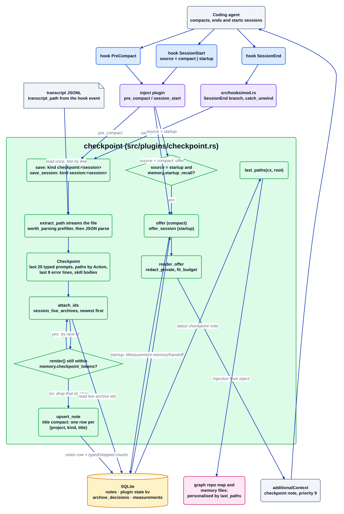

# checkpoint plugin

Source: [`checkpoint.d2`](checkpoint.d2). Module source: [`checkpoint.rs`](../../../src/plugins/checkpoint.rs). Index: [all diagrams](../README.md).

`checkpoint` is not a catalogue plugin: it has no manifest and no `[plugins.checkpoint]`
table. It is a module that `inject` (and the `SessionEnd` branch of the hook dispatcher)
call. Before a host compacts its context, or when a session ends, it distils the JSONL
transcript into a short note: the recent typed prompts, the files touched, the latest errors
and the archive ids still live. After compaction, or at the next startup, the note is read
back as one injection so the model does not start blind.

## Walkthrough

1. **Save on PreCompact.** The hook dispatcher calls `pre_compact` on every enabled plugin;
   `inject` calls `checkpoint::save(transcript_path, cx)`, which writes the note kind
   `checkpoint:<session>`.
2. **Save on SessionEnd.** The `SessionEnd` branch in `src/hooks/mod.rs` calls
   `checkpoint::save_session` inside `catch_unwind` and ignores the result. It uses the same
   extractor and render, kind `session:<session>`, filed under the project name.
3. **Extract.** `extract_path` streams the transcript line by line, so a large session is
   never held in memory. `worth_parsing` skips lines that cannot hold a path, an error, a
   typed prompt or a skill body; a test compares the filtered and unfiltered runs
   (`prefilter_is_a_true_superset_on_fixtures_and_a_large_transcript`). The result is a
   `Checkpoint`: the last 20 typed prompts, file paths with an `Action` (`Edited`, `Created`,
   `Deleted`, `Read`; changed files first), the last 8 error lines (run through
   `redact_private`) and the skill bodies the host injected.
4. **Attach archive ids.** `attach_ids` reads `session_live_archives` and adds ids newest
   first while `render()` still fits `[plugins.memory] checkpoint_tokens`; the id that
   would overflow is dropped and the loop stops.
5. **Store.** `write` calls `upsert_note(project, kind, "compact", render())`, so a repeat
   PreCompact or SessionEnd of one session replaces the note instead of adding another. It
   also stores the typed/skipped prompt counts as a plugin-state key-value row; those counts
   are a quality signal and are not a `Measurement`.
6. **Restore after compaction.** On `SessionStart` with `source = "compact"`,
   `inject::session_start` calls `checkpoint::offer`, which reads the latest note of this
   session.
7. **Restore at startup.** With `source = "startup"`, `[plugins.memory] enabled` and
   `startup_recall`, `inject` calls `checkpoint::offer_session`: the newest `session:*` note
   of the project (with a fallback to the legacy per-checkout name), plus a
   `Measurement` of kind `handoff` under plugin `memory`.
8. **Budget the injection.** `render_offer` runs `redact_private` again (older notes may hold
   a private tag), cuts the text with `fit_budget` to `checkpoint_tokens` and returns an
   `Injection` with `priority` 9. `inject` puts it in the hook's `additionalContext`.
9. **Side use.** `last_paths(cx, root)` returns the files of the latest checkpoint; the graph
   repo map and the memory files code use it to personalise their output.

## Where it lives

| Box | Code |
| --- | --- |
| PreCompact / SessionStart wiring | `src/plugins/inject/mod.rs` (`pre_compact`, `session_start`) |
| SessionEnd wiring | `src/hooks/mod.rs` (`"SessionEnd"` branch) |
| `save`, `save_session`, `write` | `src/plugins/checkpoint.rs` |
| `extract_path`, `worth_parsing` | `src/plugins/checkpoint.rs` (`extract_lines_with`) |
| `Checkpoint`, `Action`, `PathEntry` | `src/plugins/checkpoint.rs` |
| `attach_ids` | `src/plugins/checkpoint.rs` (`attach_ids`, `checkpoint_cap`) |
| `offer`, `offer_session`, `render_offer` | `src/plugins/checkpoint.rs` |
| `last_paths` | `src/plugins/checkpoint.rs`; callers in `src/plugins/graph/mod.rs` and `src/plugins/memory/files.rs` |
| Tables | `crates/rtok-store/src/schema.rs` (`notes`, `archive_decisions`, `measurements`) |
| Config | `crates/rtok-config/src/lib.rs` (`Memory`: `checkpoint_tokens`, `startup_recall`) |

## Invariants

- Hook callers never fail on it: PreCompact ignores the `save` result, and SessionEnd wraps
  `save_session` in `catch_unwind`.
- Bounded state: the extractor keeps only the last prompts and errors and the path set, so
  memory does not grow with the transcript.
- Private text is redacted before it is stored and again before it is restored.
- The restore is capped by `checkpoint_tokens`; the same transcript renders byte-identical
  text, and a test checks that Claude, pi and OpenCode restore the same body
  (`pi_and_opencode_compact_restore_bytes_match_claude`).
- The only measurement is the startup `handoff` row; no row, no saving claim.

## Related

[Overview](../overview.md) · [Plugin contract](../plugin-contract.md) ·
[inject](inject.md) · [memory](memory.md) · [graph](graph.md)
