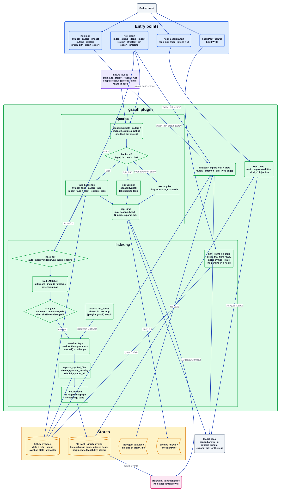

# graph plugin

Source: [`graph.d2`](graph.d2). Plugin docs: [README](../../../src/plugins/graph/README.md). Index: [all diagrams](../README.md).

`graph` replaces several code-graph servers with a few capped tools over a symbol index rtok builds
itself with tree-sitter tags: definitions, reference sites and, for each reference, the innermost
enclosing definition, which is the call edge `callers` and `impact` walk. It is a tags index, not a
type-resolved call graph. Indexing is incremental and never runs on the hook path; every answer is
capped at `plugins.graph.max_tokens`, and the uncut text stays reachable through `expand <id>`.

## Walkthrough

1. **A call enters.** The MCP tools `symbol`, `callers`, `impact`, `outline`, `explore`,
   `graph_diff` and `graph_export` are listed by `Graph::mcp_tools` and routed in `src/mcp.rs`
   `invoke`. That arm registers the project (`auto_add_project`), opens a `graph_events` record
   (`events::Call`), resolves the project scope with `scope::resolve` (the project asked for plus the
   projects it links to), and later prepends `health::notice`. The `rtok graph` subcommands (`index`,
   `status`, `dead`, `impact`, `review`, `affected`, `diff`, `export`, `projects`) reach the same code
   from `src/cli/graph.rs`.
2. **Indexing is on demand.** Each query first calls `index_for`: with `auto_index = true` it runs
   `index::run`, otherwise `index::ensure` indexes a root with no rows once. `walk::Matcher` walks
   the tree under the ignore rules, include and exclude settings and the extension map; the stat
   gate skips a file whose mtime and size are unchanged, and the sha gate skips one whose sha256 is
   unchanged. Changed files are parsed in parallel with the tags queries shared with the `read`
   plugin, and every write stays on one thread: `replace_symbol_files`, `delete_symbols_missing`,
   `rebuild_symbol_idf`. A changed extractor fingerprint drops the root's rows and re-indexes cold.
3. **The file graph is refreshed.** When a run changed the root, `rank::refresh` rebuilds the file
   PageRank document (`file_rank`, with git co-change pairs from `kv` as extra edges), so
   SessionStart can rank files without scanning `symbols`.
4. **Freshness without parsing.** `PostToolUse` for `Edit` or `Write` only calls
   `mark_symbols_stale`, which drops that file's rows and notes it in `symbol_stale`. With
   `[plugins.graph] watch` not `off`, `watch::run_scope` is a thread inside `rtok mcp` that calls
   `index::run_changed` on file events, so there is still one writer.
5. **Per-project fan-out.** `graph::call` hands the tool to `scope::symbols`, `callers`, `impact`,
   `explore` or `outline`, which loop over the scope's members and join the answers under one cap.
6. **Backend choice.** Per project, `text_or` first checks `text::applies`; otherwise the `door`
   picks by `backend`: `tags` answers from the index; `lsp` and `auto` ask the capability record
   (`capability::ask`, probed once) and call `lsp::Session`, falling back to tags headed
   `(tags; lsp: <reason>)` when the server is missing, dead, or returns nothing for a name the index
   knows. `text` answers by an in-process regex search headed `(text)`.
7. **The tags answers.** `symbol_tags` prints definitions with source up to `body_lines`;
   `callers_tags` groups reference rows by calling definition (no name lists unreferenced
   definitions); `impact_tags` walks call edges breadth-first to `depth`, adds git co-change
   partners and, past `impact_tokens`, groups files with `blast.rs`; `explore_tags` resolves the
   query's identifiers to definitions, adds caller chains between them and one impact line each;
   `outline` reuses the `read` map.
8. **Cap.** `cap_kind` archives text over `max_tokens`, prints the head plus `N more, expand <id>`,
   and records a `Measurement` only when the answer was shortened. A stored HEAD that differs from
   the live one prefixes `index <old> head <new>`.
9. **Other readers.** `graph_diff` (`diff::call`) compares symbols against git refs read from git's
   object database; `graph_export` (`export::call`) emits redacted `rtok.graph.v1` JSON (the CLI can
   draw it with `draw.rs`); `review` and `affected` rank a git diff; `drill`, `diff::page` and the
   export frames feed the web and TUI graph pages.
10. **Repo map.** At SessionStart, with `map_tokens > 0`, `repo_map` offers `rank::map` (or the
    top-referenced names) as a priority 1 `Injection`, which `inject` budgets.

## Where it lives

| Box | Code |
| --- | --- |
| `Graph` plugin, `mcp_tools`, `post_tool`, `session_start` | `src/plugins/graph/mod.rs` |
| MCP routing, `events::Call`, `health::notice` | `src/mcp.rs` (`invoke`), `src/plugins/graph/events.rs`, `health.rs` |
| `rtok graph` | `src/cli/graph.rs` (`GraphCmd`) |
| `index_for`, `index::run`, `run_changed`, `ensure` | `src/plugins/graph/mod.rs`, `src/plugins/graph/index.rs` |
| `walk::Matcher` | `src/plugins/graph/walk.rs` |
| `rank::refresh`, `rank::map` | `src/plugins/graph/rank.rs`, `cochange.rs` |
| `watch::run_scope` | `src/plugins/graph/watch.rs` |
| `scope::*` | `src/plugins/graph/scope.rs` (`resolve`, `symbols`, `callers`, `impact`, `explore`) |
| backend door | `src/plugins/graph/mod.rs` (`text_or`, `lsp_or_tags`, `door`), `capability.rs`, `lsp.rs`, `text.rs` |
| tags backends | `src/plugins/graph/mod.rs` (`symbol_tags`, `callers_tags`, `impact_tags`, `explore_tags`), `blast.rs` |
| `cap_kind` | `src/plugins/graph/mod.rs` |
| diff, export, review | `diff.rs`, `export.rs`, `draw.rs`, `review.rs`, `drill.rs` |
| symbol store | `crates/rtok-store/src/symbols.rs`, `symbol_graph.rs` (`symbols`, `symbol_stale`, `extractor`, `file_rank`, `kv`, `graph_events` tables) |

## Invariants

- Native only: the index is built here from tree-sitter tags; no external graph tool is spawned or linked.
- Indexing never runs on the hook path; PostToolUse(Edit|Write) only marks a file stale, and one
  writer owns the store (the watcher is a thread in `rtok mcp`).
- Every response is capped at `plugins.graph.max_tokens` and carries an archive id when truncated;
  a `Measurement` row exists only when an answer was shortened.
- The `symbols` rows are scoped to the canonical root, so one store holds many repos.
- A backend that cannot answer falls open to the tags index, and the answer says which backend spoke.
- Config keys: `[plugins.graph] enabled`, `max_tokens`, `body_lines`, `impact_tokens`, `map_tokens`,
  `map_rank`, `auto_index`, `backend`, `watch`.

## Related

[Overview](../overview.md) · [Plugin contract](../plugin-contract.md) · [MCP flow](../mcp-flow.md) · [read plugin](read.md) · [guard plugin](guard.md) · [inject plugin](inject.md)
