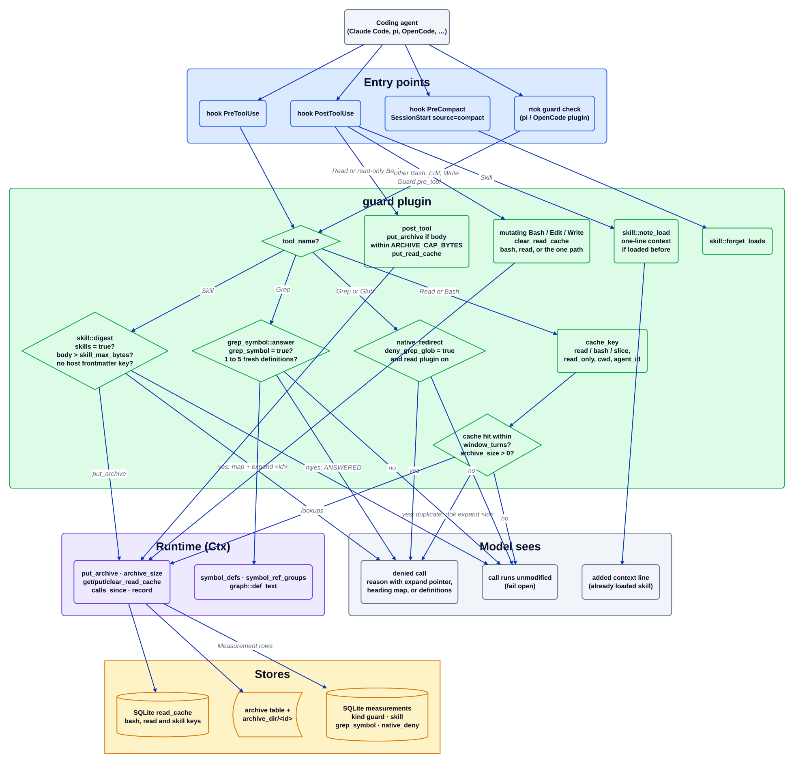

# guard plugin

Source: [`guard.d2`](guard.d2). Plugin docs: [README](../../../src/plugins/guard/README.md). Index: [all diagrams](../README.md).

`guard` stops the model from paying twice for the same result. After a read-only tool call it
archives the result and remembers a key for it; if the identical call comes back within
`window_turns` it denies the call with a pointer to the archived copy. Two opt-in paths use the
same `PreToolUse` seam: digesting an oversized `SKILL.md`, and answering a one-identifier `Grep`
from the symbol index.

## Walkthrough

1. **A tool call arrives.** Claude Code runs `PreToolUse`; pi and OpenCode ask `rtok guard check`
   (`guard::check`), which builds the same `PreToolUse` event and returns `{"allow": ...}` JSON.
   `GuardPlugin::pre_tool` dispatches on the tool name.
2. **Skill.** `skill::digest` returns `None` unless `[plugins.guard] skills = true`. It resolves
   `SKILL.md` from the skill name only (`resolve` rejects `/`, `\` and `..`), and `decide` lets
   the skill load whole when the body is within `skill_max_bytes` or its frontmatter names
   `allowed-tools`, `model`, `context` or `agent`. Otherwise it archives the body and denies with
   the heading map and `[rtok <id> · N lines · expand: rtok expand <id>]`, recording
   `Measurement { kind: "skill" }`.
3. **Grep.** With the `graph` feature and `grep_symbol = true`, `grep_symbol::answer` classifies
   the pattern with `symbol_name`, looks the name up in the index with `symbol_defs` (never
   indexing on the hook path), and denies with the definitions when there are one to five of
   them and each still matches its file line. Anything else falls through to `native_redirect`,
   which with `deny_grep_glob = true` and the `read` plugin enabled denies `Grep`/`Glob` and
   points at MCP `search` / `tree` (`kind: "native_deny"`).
4. **Duplicate Read or Bash.** `cache_key` builds a key: `read\t<path>` (plus a slice suffix for
   `offset`/`limit`/`pages`), or `bash\t<cwd>\t<normalised command>` for a read-only command
   only, suffixed with the sub-agent id when there is one. `get_read_cache` finds the earlier
   hit, `calls_since` measures its age against `window_turns`, and `archive_size` confirms the
   original still exists. The deny is `duplicate; rtok expand <id>`, with
   `Measurement { kind: "guard" }` carrying the avoided bytes.
5. **PostToolUse stores.** For a keyed call, `post_tool` archives the response with
   `put_archive` and writes the key with `put_read_cache`. A body above `ARCHIVE_CAP_BYTES` is
   not archived and its key is cleared, so no later deny can point at nothing.
6. **PostToolUse invalidates.** A mutating Bash, Edit or Write is not keyed: it clears the `bash`
   keys, and either every `read` key (Bash, or an Edit/Write path with no stable identity) or
   the one `read\t<path>` key. A kept `cd` hop also clears the `bash` keys.
7. **Skill loads.** `skill::note_load` records each load in the read cache and, when the same skill
   loads again before a compaction, returns one added-context line. `PreCompact` and
   `SessionStart` with `source == "compact"` call `skill::forget_loads`.

## Where it lives

| Box | Code |
| --- | --- |
| `GuardPlugin::pre_tool` / `post_tool` / `pre_compact` / `session_start` | `src/plugins/guard/mod.rs` (`impl Plugin for GuardPlugin`) |
| `rtok guard check` | `src/cli/guard.rs`, `src/plugins/guard/mod.rs` (`check`) |
| `cache_key`, `read_only`, `norm_cmd` | `src/plugins/guard/mod.rs`, `src/plugins/guard/sed.rs` (`script_read_only`) |
| `native_redirect` | `src/plugins/guard/mod.rs` |
| `skill::digest`, `note_load`, `forget_loads` | `src/plugins/guard/skill.rs` |
| `grep_symbol::answer` | `src/plugins/guard/grep_symbol.rs` (`answer`, `symbol_name`) |
| read cache, archive, measurements | `crates/rtok-store/` (`read_cache`, `archive`, `measurements` tables) through `Ctx` |

## Invariants

- Deny only when the archived original exists (`archive_size` is non-zero); otherwise the call runs.
- Only read-only Bash is keyed, the cwd and every `cd` hop are part of the key, and a Bash behind a
  relative `cd` hop has no key.
- The hook path does one indexed lookup plus a file-existence check and never reads an archive body,
  inside the 10 ms hook budget.
- A `guard` or `skill` denial writes a `Measurement`; `grep_symbol` and `native_deny` rows count
  the event but claim no saving.
- A skill whose frontmatter carries a host key, or any parse or read error, loads whole.
- Config keys: `[plugins.guard] enabled`, `window_turns`, `grep_symbol`, `skills`,
  `skill_max_bytes`, `deny_grep_glob`.

## Related

[Overview](../overview.md) · [Plugin contract](../plugin-contract.md) · [read plugin](read.md) · [archive plugin](archive.md) · [graph plugin](graph.md)
