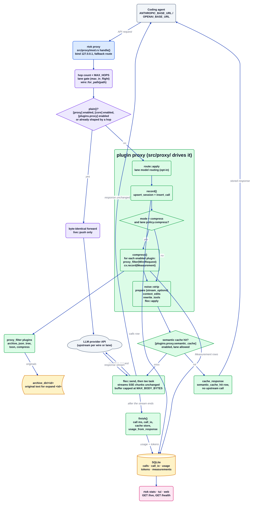

# proxy plugin

Source: [`proxy.d2`](proxy.d2). Plugin docs: [README](../../../src/plugins/proxy/README.md). Index: [all diagrams](../README.md).

The `proxy` plugin is the usage-capture side of the proxy surface. `rtok proxy` is a local
HTTP hop that a host reaches through `ANTHROPIC_BASE_URL` or `OPENAI_BASE_URL`. The plugin
itself is only a manifest (`Surface::Proxy`, `default_on: true`); the server in `src/proxy/`
is its implementation. It records every request and the provider's real `usage`, and in
`compress` mode it is the stage where other plugins' `proxy_filter` methods shorten the
request before it leaves.

## Walkthrough

1. **A request arrives.** The axum fallback `proxy` calls `handle`. It classifies the lane
   (`lane::classify`), rejects a request that already passed `MAX_HOPS` rtok hops with
   status 508, and takes the lane's `max_in_flight` slot if one is configured.
2. **Plain mode.** `ProxyState::plain()` is true when `[proxy] enabled`, `[core] enabled` or
   `[plugins.proxy] enabled` is false, and a request that an earlier rtok hop already shaped
   is treated the same way. A plain request is forwarded byte for byte and only appears in the
   `/live` ring (`live::push`).
3. **Shape the request.** `shape_request` runs on a blocking thread. `route::apply` may swap
   the model for a non-agent lane, then `record` upserts the session and inserts the `calls`
   row.
4. **Compress.** When `[proxy] mode = "compress"` and the lane policy allows it, `compress`
   opens a `Runtime`, walks `Registry::enabled()` and calls each plugin's `proxy_filter` on a
   `WireRequest` (today `archive`, `json_tree`, `toon`, `compress`). `archive` is skipped when
   the platform's context edits are armed, and `toon` when the lane policy has it off. Every
   returned `Measurement` goes through `cx.record`. If nothing changed, the original bytes go
   out.
5. **Provider shaping.** `noise::strip` (compress mode only), `prepare` (OpenAI
   `stream_options`), `context_edits`, `rewrite_tools` (`[proxy.tools_rewrite]`) and
   `flex::apply` follow, each behind its own switch. `rewrite_tools` archives the original
   `tools[]` and stores its id in `Measurement.ref_id`.
6. **Semantic cache.** With `[plugins.proxy.semantic_cache] enabled` and a lane that allows
   it, `semantic_cache::build_prompt` and `Cache::lookup` may answer from memory.
   `cache_response` then records a `semantic_cache_hit` row and the usage decoded from the
   stored body, and no upstream call happens.
7. **Forward and tee.** `flex::send` sends the request to the lane, wire or default upstream.
   A spawned task copies each chunk to the client unchanged (SSE is never buffered for the
   client) while keeping a capped copy for bookkeeping.
8. **Record the response.** `finish` sets `calls.ms`, writes `call_io`, fills the cache for
   complete bodies, and inserts the `usage` row (and the provider `tokens` row when a usage block was
   parsed with `wire::usage_from_response`).
9. **Operators read it.** `rtok stats`, `rtok tui` and `rtok web` read these rows; `GET /health`
   and `GET /live` are served by `src/proxy/cli.rs`.

## Where it lives

| Box | Code |
| --- | --- |
| rtok proxy, guards | `src/proxy/mod.rs` (`app`, `handle`, `hops_of`, `MAX_HOPS`) |
| plain? | `src/proxy/mod.rs` (`ProxyState::plain`) |
| route, record | `src/proxy/route.rs` (`apply`), `src/proxy/mod.rs` (`shape_request`, `record`) |
| compress | `src/proxy/mod.rs` (`compress`); `Plugin::proxy_filter` in `crates/rtok-plugin-sdk/` |
| proxy_filter plugins | `src/plugins/archive/`, `src/plugins/json_tree/`, `src/plugins/toon/`, `src/plugins/compress/` |
| provider shaping | `src/proxy/noise.rs`, `src/proxy/anthropic.rs` (`apply_context_edits`), `src/proxy/tools_rewrite.rs`, `src/proxy/flex.rs` |
| wire adapters | `src/proxy/wire.rs`, `anthropic.rs`, `openai_chat.rs`, `openai_responses.rs`, `gemini.rs` |
| semantic cache | `src/proxy/semantic_cache.rs`, `src/proxy/mod.rs` (`cache_response`) |
| tee, finish | `src/proxy/mod.rs` (`handle`, `finish`, `record_usage`) |
| Manifest | `src/plugins/proxy/mod.rs` (`ProxyPlugin`) |
| Config | `crates/rtok-config/` (`[proxy]`, `[proxy.lanes.<lane>]`, `[plugins.proxy]`) |
| Tables | `crates/rtok-store/` (`calls`, `call_io`, `usage`, `tokens`, `measurements`) |

## Invariants

- Fail open: an unparseable body, a panicked shaping task, a store error or an unchanged
  result forwards the original bytes, and the request is never refused for bookkeeping.
- Plain mode changes zero bytes; `plugins.proxy.enabled = false` also stops the `calls`,
  `call_io` and `usage` rows.
- Every shaped request inserts one `usage` row; an error or usage-less response still owes
  an all-zero row.
- Lossless: a rewrite by a plugin archives the original first, and `expand <id>` recovers it.
- A routed call, a context-management call and a cache hit write rows that claim no token
  saving of their own; savings are only the rows plugins record.
- The listener binds `[proxy] bind` (default `127.0.0.1`), and the client's
  `accept-encoding` is replaced with `identity` so the tee can read the body.

## Related

[Overview](../overview.md) · [Plugin contract](../plugin-contract.md) · [Proxy flow](../proxy-flow.md) ·
[archive](archive.md) · [toon](toon.md) · [json_tree](json_tree.md) · [compress](compress.md)
