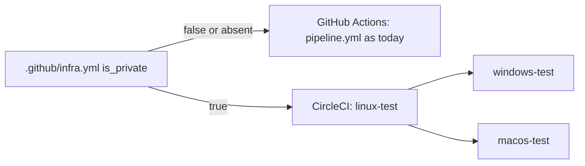

# CircleCI for private repositories (pilot)

pyrlyn picks the CI per repository with one flag in `.github/infra.yml`:

```yaml
version: 1
is_private: false   # true: CircleCI runs, GitHub Actions checks are skipped
```



- `is_private: true`: `.circleci/config.yml` runs Linux unit tests, then Windows and macOS.
  pyrlyn/ci skips its checks and `gate` still reports success (needs the pyrlyn/ci change
  with the `is_private` key and a bumped pin).
- `false` or absent: GitHub Actions unchanged. CircleCI, if the project is followed, halts
  every job right after checkout (`circleci-agent step halt`), which costs seconds of credits.

rtok is public, so it has `is_private: false`; the config is here as the pattern.

## Setup

1. An org owner installs the CircleCI GitHub App on pyrlyn (can be limited to selected repositories).
2. In CircleCI, set up the project for the repository (follow it), using `.circleci/config.yml`.
3. Do not make CircleCI checks required in the rulesets yet; keep `gate` as the required check.

## Free plan limits

30,000 credits a month (about 3,000 Linux medium minutes), Windows medium 40 credits/min,
macOS M4 Pro medium 200 credits/min and 1 concurrent macOS job, 30 concurrent jobs, 5 active
users, 2 GB storage. The Linux cache keeps only the registry and `target` without incremental
data; drop the cache or bump `v1` in the key if storage grows.

## Other repositories

Copy `.circleci/config.yml`, adjust the test commands, set `is_private: true`. A private orb in
pyrlyn could later hold the shared jobs instead of copies.

## Renovate

`renovate.json` extends `config:recommended`. pyrlyn already runs self-hosted Renovate from
pyrlyn/ci (mise only); Dependabot still handles Cargo and GitHub Actions, so the two overlap
for those managers until one is turned off. The free Mend Renovate app supports private
repositories too.
