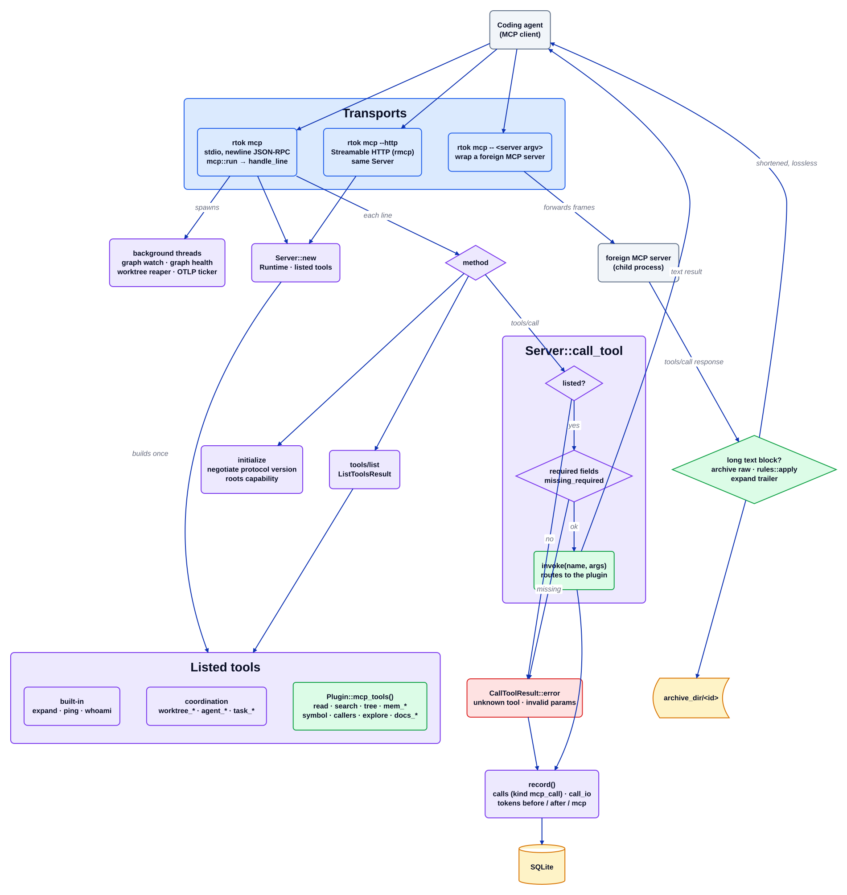

# Поток MCP

Исходник: [`mcp-flow.d2`](../../architecture/mcp-flow.d2). Индекс: [все диаграммы](README.md).

`rtok mcp` — это поверхность, которая может *заменить* инструмент хоста, а не только украсить его: агент, который вызывает
`read` или `search` rtok, получает сокращённый ответ напрямую, чего никогда не может дать хук PostToolUse (D2). Тот же
`Server` отвечает через stdio и через HTTP, а третий режим оборачивает чужой MCP-сервер и сокращает его длинные результаты
без потерь.

## Пошагово

1. **Старт.** `mcp::run` строит `Server` (один `Runtime` на процесс), запускает задачу очистки хранилища и таймер OTLP и
   порождает фоновые потоки: наблюдатель файлов `graph` (если не `plugins.graph.watch = "off"`), проверку состояния графа,
   сборщик рабочих деревьев (когда `worktree.enabled`) и обновление отслеживаемых проектов графа.
2. **Перечисление инструментов один раз.** `Server::new` собирает встроенные (`expand`, `ping`, `whoami`), координационные
   инструменты (`worktree_*`, `agent_send`/`agent_inbox`, `agents_list`, `agent_show`, `agent_status_set`, `task_*`) и
   `Plugin::mcp_tools()` каждого включённого плагина из дерева. Внешние плагины WASM не перечисляются, потому что у `invoke`
   для них нет ветки.
3. **Чтение строки.** Цикл stdio читает одну строку JSON-RPC (пакетный массив получает ответ массивом), и `handle_line`
   маршрутизирует по методу: `initialize` согласует версию протокола и отмечает, предлагает ли клиент `roots`;
   уведомления не получают ответа; `tools/list` возвращает перечисленные инструменты.
4. **Проверка вызова.** `call_tool` сначала нормализует алиасы аргументов (`prepare_args`), затем отклоняет инструмент, которого
   нет в списке, и вызов без поля, которое требует собственный `input_schema` инструмента. Оба случая отвечают
   `CallToolResult::error`, чтобы агент видел причину.
5. **Вызов.** `invoke` направляет имя владельцу: `read`/`search`/`tree` — плагину `read`, `mem_*` и `handoff` — `memory`,
   `symbol`/`callers`/`impact`/`outline`/`explore`/`graph_diff`/`graph_export` — `graph` (в области `graph::scope::resolve`),
   `docs_*` — `docs`, `expand` — архиву. Плагин, который сокращает ответ, хранит оригинал за id `expand`; сам `expand`
   ограничивает большой оригинал через `cap_result`, оставляя маркер `expand(<id>)`, по которому можно листать.
6. **Запись.** Каждый вызов, успешный или нет, проходит через `record`: одна строка `calls` (`kind = mcp_call`, плагин и
   имя инструмента), её `call_io` и три строки `tokens` (аргументы как `before`, результат как `after` и как строка `mcp`
   плагина).
7. **HTTP.** `rtok mcp --http` отдаёт тот же `Server` по MCP Streamable HTTP; rmcp отвечает за протокол, включая проверки
   Host и Origin, и передаёт только `tools/list` и `tools/call` тем же проверкам, диспетчеризации и `record`.
8. **Обёртка.** `rtok mcp -- <server argv>` запускает чужой MCP-сервер через stdio и пересылает каждый кадр без изменений,
   кроме ответа `tools/call`, текстовые блоки которого превышают правило `[mcp]` cmd: каждый такой блок архивируется
   в исходном виде, обрезается через `rules::apply` и закрывается тем же хвостом `expand`, что печатает `rtok run`. Если
   хранилище не открывается, обёртка работает как простой канал.

## Где это находится

| Блок | Код |
| --- | --- |
| stdio-сервер | `src/mcp.rs` (`run`, `Server`, `handle_line`, `call_tool`, `invoke`, `record`) |
| HTTP | `src/mcp/http.rs` |
| Обёртка | `src/mcp/wrap.rs` |
| Координационные инструменты | `src/mcp/worktrees.rs`, `src/mcp/messages.rs`, `src/mcp/agents.rs`, `src/mcp/tasks.rs` |
| Плагинные инструменты | `src/plugins/read/`, `src/plugins/memory/`, `src/plugins/graph/`, `src/plugins/docs/` |
| Журнал учёта | `crates/rtok-store/` (`insert_call`, `insert_call_io`, `insert_tokens`) |

## Инварианты

- Инструмент, которого нет в списке, нельзя вызвать ни через stdio, ни через HTTP.
- Результат, который rtok сокращает, всегда несёт id `expand`; оригинал находится в архиве.
- Обёртка никогда не меняет кадр, который не сокращает, и никогда не роняет чужой сервер.

## Связанное

[Обзор](overview.md) · [Поток хука](hook-flow.md) · [Поток прокси](proxy-flow.md) ·
[read](plugins/read.md) · [memory](plugins/memory.md) · [graph](plugins/graph.md) ·
[archive](plugins/archive.md)
