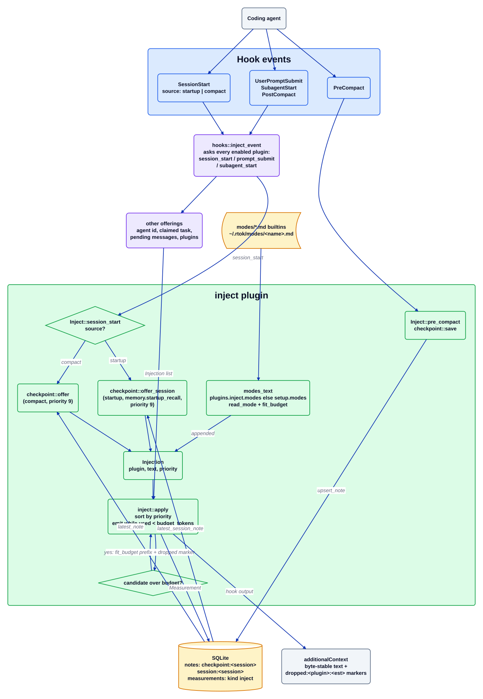

# Плагин inject

Источник: [`inject.d2`](../../../architecture/plugins/inject.d2). Документация плагина: [README](../../../../src/plugins/inject/README.md). Оглавление: [все диаграммы](../README.md).

`inject` — это дверь в контекст SessionStart, PostCompact, UserPromptSubmit и SubagentStart. Диспетчер хуков собирает `Injection { plugin, text, priority }` от каждого включённого плагина, затем `inject::apply` выводит их под одним бюджетом, поэтому ничто не попадает к модели без бюджета. Плагин также вносит собственные предложения (контрольную точку сжатия (checkpoint), передачу предыдущей сессии и настроенные режимы промпта) и записывает контрольную точку при `PreCompact`.

## Пошагово

1. **Срабатывает событие хука.** `hooks::inject_event` в `src/hooks/mod.rs` вызывает `session_start`, `prompt_submit` или `subagent_start` у каждого включённого плагина (событие `PostCompact` диспетчеризуется как `session_start` с `source: "compact"`). Паникующий плагин записывается в журнал и пропускается.
2. **Присоединяются дополнительные предложения.** Диспетчер добавляет строку id агента (SessionStart и SubagentStart), строку назначенной задачи (SessionStart и PostCompact) и ожидающие сообщения (UserPromptSubmit); все они идут под тем же бюджетом.
3. **`InjectPlugin::session_start` выбирает свой текст.** При `compact` он запрашивает у `checkpoint::offer` контрольную точку этой сессии; при `startup`, когда включён `[plugins.memory] startup_recall`, он запрашивает у `checkpoint::offer_session` передачу последней сессии проекта. Любой из них имеет приоритет 9.
4. **Режимы добавляются.** `modes_text` берёт `[plugins.inject] modes`, а при их отсутствии — `[setup] modes`. Каждое имя разрешается в `<modes_dir>/<name>.md` или во встроенный режим (`terse` / `cave`, `yagni` / `pony`, `nudges`, встроенные через `include_str!`), читается ограниченным `read_mode` и подгоняется под бюджет. Текст соединяется в тот же `Injection`, чей приоритет равен 5, или 9, когда раньше пришёл текст контрольной точки или передачи. Только `session_start` добавляет текст режимов.
5. **`apply` соблюдает бюджет.** `inject::apply` сортирует по приоритету (при равенстве по id плагина), выводит кандидатов, пока `used < budget_tokens`, а для кандидата сверх бюджета оставляет префикс `fit_budget` и маркер `dropped:<plugin>:<est>`. Остальные обозначаются только маркерами.
6. **Записывается измерение.** `Measurement { kind: "inject" }` несёт предложенные и выведенные байты и оценки; `ref_id` содержит первый маркер отбрасывания. Если предложений нет вообще, ничего не записывается.
7. **PreCompact сохраняет.** `InjectPlugin::pre_compact` вызывает `checkpoint::save`, который обходит транскрипт потоком и обновляет (upsert) строку `notes` вида `checkpoint:<session>`; SessionEnd записывает строку `session:<session>`, которую позже читает `offer_session`.

## Где это находится

| Блок | Код |
| --- | --- |
| `hooks::inject_event` | `src/hooks/mod.rs` (`inject_event`) |
| `InjectPlugin::session_start`, `pre_compact` | `src/plugins/inject/mod.rs` (`impl Plugin for InjectPlugin`) |
| `modes_text`, `read_mode`, `builtin` | `src/plugins/inject/mod.rs` |
| `inject::apply` | `src/plugins/inject/mod.rs` (`apply`) |
| `checkpoint::offer`, `offer_session`, `save` | `src/plugins/checkpoint.rs` |
| Встроенные режимы | `modes/terse.md`, `modes/yagni.md`, `modes/nudges.md` |
| Ключ бюджета | `crates/rtok-config/src/lib.rs` (`plugins.inject.budget_tokens`, `modes_dir`) |

## Инварианты

- Бюджет — жёсткий предел: `plugins.inject.budget_tokens` (по умолчанию 800) ограничивает то, что выводит `apply`, а обрезанное обозначается маркером `dropped:`. Тест: `three_500_budget_800_drops_one_and_is_byte_stable`.
- Вывод SessionStart побайтно стабилен при неизменном состоянии: в тексте, который предлагает `inject`, нет временных меток и счётчиков.
- Режимы — это данные в файлах markdown, а не строки в Rust; отсутствующий или нечитаемый файл откатывается ко встроенному режиму, а неизвестное имя пропускается.
- `UserPromptSubmit` никогда не несёт текст режимов (`session_start` — единственное место, где он добавляется).
- `core.inject_budget_tokens` — удалённый псевдоним: он принимается из старых конфигураций и переносится в `plugins.inject.budget_tokens`.

## Связанное

[Обзор](../overview.md) · [Контракт плагина](../plugin-contract.md) · [Ход хуков](../hook-flow.md) · [плагин memory](memory.md) · [плагин guard](guard.md)
