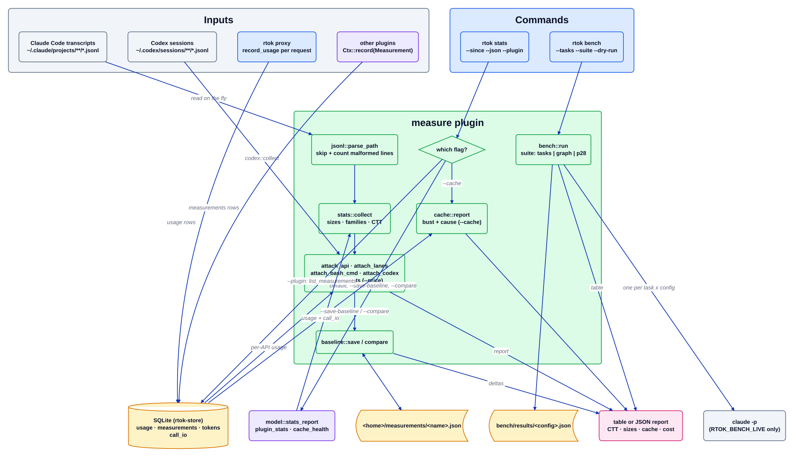

# Плагин measure

Источник: [`measure.d2`](../../../architecture/plugins/measure.d2). Документация плагина: [README](../../../../src/plugins/measure/README.md). Оглавление: [все диаграммы](../README.md).

`measure` — это эталон, по которому судят другие плагины: ничто не выпускается, пока не может показать число «до» и «после». Сама структура плагина лишь объявляет манифест (поверхности `Cli` и `Proxy`, включён по умолчанию) и страницу дашборда; работа находится в `src/measure/`, `src/bench.rs` и командах `rtok stats` / `rtok bench`, которые к ним обращаются. Он никогда не стоит на пути хука.

## Пошагово

1. **Входные данные.** Три источника его питают: транскрипты агентов, разбираемые на лету (JSONL Claude Code, события `token_count` Codex), строки `usage`, которые прокси записывает на каждый запрос (`record_usage` в `src/proxy/mod.rs`, через `Store::insert_usage`), и строки `measurements`, которые другие плагины записали через `Ctx::record`.
2. **Выбрать представление.** `src/cli/stats.rs` сначала ветвится по флагу: `--calibrate` выводит `calibrate_or_skip`; `--cache` рендерит `cache::report` (ходы, где создание кэша подскочило, а чтения кэша упали, с причиной, прочитанной из тел `call_io`); `--plugin <id>` возвращает строки `measurements` этого плагина через `model::plugin_stats`; всё остальное строит полный отчёт в `model::stats_report`.
3. **Разбор.** `jsonl::parse_path` читает один JSON-объект на строку. Некорректная строка учитывается в `Parsed::malformed` и не является фатальной; нечитаемый транскрипт считается одной некорректной записью.
4. **Сбор.** `stats::collect` обходит транскрипты в порядке путей, пропускает файлы субагентов (`subagents::is_subagent`; их относят к родителю) и сворачивает сессии в `Report`: размеры результатов по инструментам, семейства команд Bash (`bash_family`), группы MCP и context-token-turns.
5. **Присоединить данные хранилища.** `model::stats_report` открывает хранилище (для отчёта оно необязательно) и вызывает `attach_api`, `attach_lanes`, `attach_bash_cmd`, `attach_checkpoint_notes` и `attach_costs` при установленном `--price`; `attach_codex` добавляет запросы Codex.
6. **Базовые линии.** `--save-baseline <name>` записывает JSON отчёта в `<home>/measurements/<name>.json` (`baseline::save`, который отвергает имена с разделителями путей); `--compare <name>` выводит дельты через `baseline::compare`. Иначе отчёт печатается таблицей или, с `--json`, JSON.
7. **Бенчмарк.** `rtok bench` вызывает `bench::run`: набор по умолчанию запускает шесть задач по `[bench.configs]`, `--suite graph` сравнивает работу с MCP-сервером rtok и без него, а `--suite p28` запускает набор p28. Без `RTOK_BENCH_LIVE` он возвращает ноль строк вместо запуска агента. Результаты попадают в `results/<config>.json` рядом с файлом задачи.

## Где это находится

| Блок | Код |
| --- | --- |
| Манифест плагина measure | `src/plugins/measure/mod.rs` (`Measure`) |
| `jsonl::parse_path` | `src/measure/jsonl.rs` (`Parsed`, `parse_jsonl`, `parse_dir`) |
| `stats::collect` | `src/measure/stats.rs` (`collect`, `Report`, `bash_family`) |
| Шаги присоединения | `src/measure/stats.rs` (`attach_api`, `attach_lanes`, `attach_bash_cmd`, `attach_codex`, `attach_costs`) |
| `cache::report` | `src/measure/cache.rs` (`analyse`, `report`, `SessionHealth`) |
| `baseline::save / compare` | `src/measure/baseline.rs` |
| `model::stats_report` | `src/model/mod.rs` (`stats_report`, `plugin_stats`, `cache_health`) |
| `rtok stats` | `src/cli/stats.rs` |
| `bench::run` | `src/bench.rs`, `src/bench/p28.rs`, `src/cli/bench.rs` |
| Сбор usage прокси | `src/proxy/mod.rs` (`record_usage`) |
| Чтение Codex | `src/measure/codex.rs` (`requests`, `collect`) |
| `Ctx::record` | `src/plugin.rs` (`Runtime::record`) |

## Инварианты

- Только строки `Measurement` считаются экономией; числа из транскриптов — оценки, а строки `usage` прокси — единственные реальные подсчёты провайдера.
- Некорректная строка транскрипта пропускается и учитывается; она никогда не прерывает отчёт.
- Чтения транскриптов и Codex никогда не записываются в хранилище, поэтому повторное чтение идемпотентно.
- `--calibrate` — единственный вызов, похожий на сетевой, и без ключа API он печатает `skipped`.
- Если хранилище не открывается, `rtok stats` теряет только таблицу API, кроме `--plugin` и `--cache`, которым хранилище необходимо.

## Связанное

[Обзор](../overview.md) · [Контракт плагина](../plugin-contract.md) · [плагин proxy](proxy.md) · [плагин archive](archive.md)
