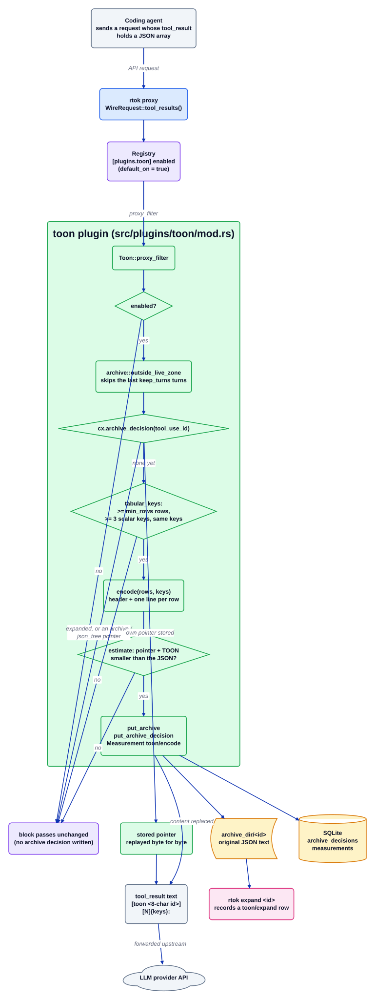

# Плагин toon

Источник: [`toon.d2`](../../../architecture/plugins/toon.d2). Документация плагина: [README](../../../../src/plugins/toon/README.md). Оглавление: [все диаграммы](../README.md).

`toon` перекодирует массив JSON однородных объектов из старого результата инструмента в строку-заголовок и по одной строке на каждую запись через запятую. Повтор каждого ключа в каждой строке и есть то, что стоит токенов в исходнике. Плагин работает только на поверхности прокси, через `Plugin::proxy_filter`, и переписывает только тогда, когда его собственная оценка токенов показывает, что результат меньше.

## Пошагово

1. **Прокси предлагает результаты инструментов.** `rtok proxy` строит `WireRequest`; `ToonPlugin::proxy_filter` сразу возвращает управление, когда `[plugins.toon] enabled` равно false (в манифесте `default_on: true`).
2. **Живая зона пропускается.** `rewrite` берёт `min_rows` из конфигурации и пропускает результаты через `archive::outside_live_zone`, так что последние `[plugins.archive] keep_turns` ходов остаются побайтно идентичными.
3. **Сохранённое решение побеждает.** `rewrite_block` читает текст результата инструмента через `archive::block_text` (или JSON голого массива) и ищет `cx.archive_decision(tool_use_id)`. Раскрытый id или указатель, записанный `archive` или `json_tree` (`skips_foreign_pointer`), не трогается. Указатель, который начинается с `[toon `, воспроизводится как записан и измеряется как строка `toon`/`encode`.
4. **Только однородные таблицы подходят.** `tabular_keys` принимает массив не менее чем из `min_rows` объектов (ключ конфигурации `min_rows`), у которых не меньше трёх ключей, одинаковые наборы ключей и только скалярные значения, и чьи ключи не требуют кавычек.
5. **Кодирование и проверка размера.** `encode` записывает `[N]{k1,k2,…}:` и по одной строке с отступом на запись; `needs_quotes` заключает в кавычки любую ячейку, которая иначе читалась бы как другое значение. Блок кодируется, только если оценка указателя плюс TOON меньше оценки JSON, поэтому таблица, которая бы выросла, остаётся нетронутой и не оставляет решения архива.
6. **Сначала архив, затем замена.** `cx.put_archive` сохраняет исходный текст, `cx.put_archive_decision` закрепляет замену для последующих ходов, а блок становится `[toon <8-char id>]` с последующей таблицей. Возвращается `Measurement { plugin: "toon", kind: "encode" }`, которое записывает хост.
7. **Восстановление.** `rtok expand <id>` возвращает исходный JSON и записывает строку `toon`/`expand`; после этого id никогда не перекодируется.

## Где это находится

| Блок | Код |
| --- | --- |
| ToonPlugin::proxy_filter, включён? | `src/plugins/toon/mod.rs` (`ToonPlugin::proxy_filter`) |
| outside_live_zone | `src/plugins/archive/` (`outside_live_zone`, `block_text`) |
| archive_decision | `src/plugins/toon/mod.rs` (`rewrite_block`, `skips_foreign_pointer`, `PREFIX`) |
| tabular_keys | `src/plugins/toon/mod.rs` (`tabular_keys`) |
| encode | `src/plugins/toon/mod.rs` (`encode`, `encode_cell`, `needs_quotes`) |
| Блобы архива и решения | `crates/rtok-store/` (`archive_decisions`, `measurements`), `archive_dir` |
| expand | `src/expand.rs` (`fetch`) |
| Конфигурация | `crates/rtok-config/` (`[plugins.toon]` `enabled`, `min_rows`) |

## Инварианты

- Без потерь: исходный текст архивируется до замены блока, и `expand <id>` его возвращает. `decode` существует в тестовой сборке как эталон обратного преобразования для `encode`.
- Таблица, которая не уменьшилась бы, остаётся как есть, и для неё не записывается решение архива.
- Последние ходы (`keep_turns`) никогда не трогаются, а сохранённое решение воспроизводится как записано, поэтому более ранние ходы остаются побайтно стабильными.
- `toon` никогда не воспроизводит чужой указатель (`archive`, `json_tree`), поэтому один блок даёт одну строку измерения.
- Нет строки `Measurement` — нет заявления об экономии: каждое переписывание возвращает строку `toon`/`encode`.

## Связанное

[Обзор](../overview.md) · [Контракт плагина](../plugin-contract.md) · [archive](archive.md) · [json_tree](json_tree.md) · [proxy](proxy.md)
