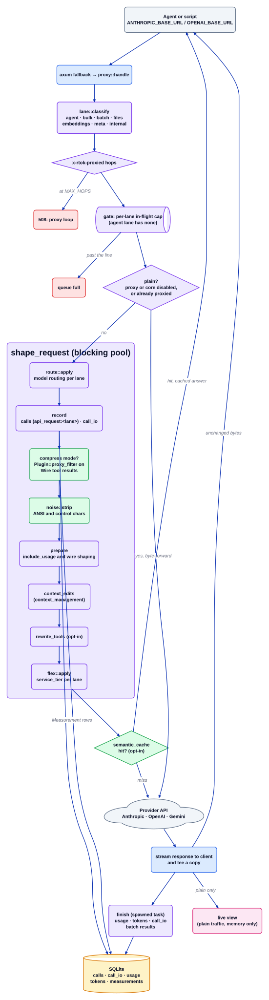

# Поток прокси

Исходник: [`proxy-flow.d2`](../../architecture/proxy-flow.d2). Индекс: [все диаграммы](README.md).

`rtok proxy` стоит на `ANTHROPIC_BASE_URL` / `OPENAI_BASE_URL`. Это единственная поверхность, которая видит весь запрос к LLM,
поэтому именно здесь можно сокращать результаты инструментов для каждого хоста и записывать реальный `usage` провайдера.
Ответ никогда не меняется: он передаётся клиенту по мере поступления, а копия читается потом для учёта.

## Пошагово

1. **Классификация.** `proxy::handle` (резервный маршрут axum) запускает `lane::classify`: `agent` — для интерактивного
   хода; `bulk`, `batch`, `files`, `embeddings`, `meta` и `internal` — для скриптов, заданий Batch, загрузок, вызовов
   эмбеддингов, получения списка моделей и подсчёта токенов, а также собственных вызовов rtok. Полоса (lane) выбирает
   политику (`[proxy.lanes.<lane>]`); полоса agent сохраняет глобальные переключатели, а `batch` и `files` никогда
   не переписываются.
2. **Отказ от циклов.** Каждый пересылаемый запрос несёт `x-rtok-proxied: <hops>`. Запрос, который уже прошёл через прокси
   rtok, пересылается как есть; при `MAX_HOPS` прокси отвечает 508.
3. **Ограничение пакетных полос.** `gate` выделяет каждой ограниченной полосе собственные слоты одновременных запросов и
   короткую очередь, чтобы всплеск пакетных запросов не отнял у агента соединения провайдера или лимит скорости; полная
   очередь отклоняется.
4. **Простой или формированный.** При выключенных `proxy.enabled` или `core.enabled` (либо для уже проксированного запроса)
   прокси работает как простой обратный прокси: байты пересылаются, ничего не записывается, а живой вид (только в памяти,
   `GET /live`) показывает трафик.
5. **Формирование.** Иначе `shape_request` выполняется в пуле блокирующих задач: `route::apply` может подменить модель для
   полосы, `record` записывает строку `calls` (`api_request` или `api_request:<lane>` вне полосы agent) и `call_io`; в режиме
   `compress` каждый включённый `Plugin::proxy_filter` сокращает результаты инструментов, которые открывает соответствующий
   `Wire`, и возвращает `Measurement`; `noise::strip` удаляет ANSI и управляющие символы; `prepare` применяет формирование,
   которое задаёт wire-формат (например, `include_usage` в потоках OpenAI); затем идут опциональные `context_edits`,
   `rewrite_tools` и Flex `service_tier`.
6. **Кэш.** Опциональный двухуровневый `semantic_cache` может ответить на повторяющийся запрос без вызова провайдера.
7. **Пересылка и tee.** Запрос уходит в `proxy.upstream` (или `proxy.openai_upstream`) с кодировкой `identity`, чтобы копия
   оставалась читаемой. Куски передаются клиенту без изменений и по мере прохода копируются в буфер.
8. **Завершение.** Порождённая задача разбирает `usage` провайдера тем же `Wire` и записывает `usage`, `tokens` (источник
   `provider`) и `call_io` ответа. С `[proxy.batch] parse_results` переданный файл результатов Batch тоже даёт строки `usage`.

## Где это находится

| Блок | Код |
| --- | --- |
| Сервер и обработчик | `src/proxy/mod.rs` (`serve`, `handle`, `shape_request`, `compress`, `record`, `finish`) |
| Полосы, шлюз, маршрутизация | `src/proxy/lane.rs`, `src/proxy/gate.rs`, `src/proxy/route.rs` |
| Форматы протоколов | `src/proxy/wire.rs`, `anthropic.rs`, `openai_chat.rs`, `openai_responses.rs`, `gemini.rs` |
| Формирование | `src/proxy/noise.rs`, `src/proxy/flex.rs`, `src/proxy/tools_rewrite.rs` |
| Кэш, живой вид, Batch | `src/proxy/semantic_cache.rs`, `src/proxy/live.rs`, `src/proxy/batch_results.rs` |
| Фильтры на стороне плагинов | [плагин proxy](plugins/proxy.md), [плагин compress](plugins/compress.md) |

## Инварианты

- Тело ответа доходит до клиента байт в байт; учёт происходит после, вне пути запроса, и его ошибки только логируются.
- Цепочка прокси rtok формирует и записывает запрос один раз.
- Batch и Flex относятся только к прокси; хуки и MCP никогда не видят тел HTTP-запросов к LLM (`docs/batch-flex.md`).

## Связанное

[Обзор](overview.md) · [Поток хука](hook-flow.md) · [Поток MCP](mcp-flow.md) ·
[Хранилище](store.md) · [плагин proxy](plugins/proxy.md) · [compress](plugins/compress.md)
