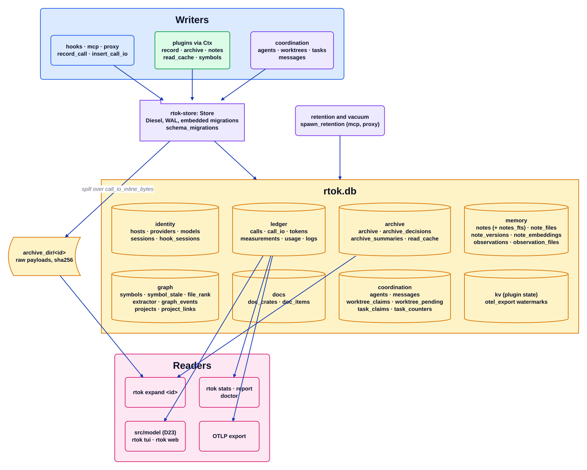

# Хранилище

Исходник: [`store.d2`](../../architecture/store.d2). Индекс: [все диаграммы](README.md).

rtok хранит один файл SQLite (D8). Хуки — короткоживущие процессы, поэтому каждый вызов открывает файл, записывает свои строки
и завершается. Режим WAL позволяет многим одновременным писателям (каждому хуку, серверу MCP, прокси) делить файл. Файл —
доказательная база продукта: экономия — это строка в `measurements`, или её не существует.

## Пошагово

1. **Один владелец.** `rtok-store` — единственный крейт, который называет Diesel. `Store::open_with` открывает файл с ограниченным
   ожиданием блокировки, переводит его в WAL, применяет встроенные миграции (`crates/rtok-store/migrations/NNNN_<slug>/`,
   записанные в `schema_migrations`) и держит файл доступным только владельцу. Крейт ничего не печатает; проблемы обслуживания
   возвращаются как `StoreWarning`.
2. **Строки идентичности** (`hosts`, `providers`, `models`, `sessions`) вставляются или обновляются, и на них ссылается каждый
   вызов. `hook_sessions` хранит поля сессии хука один раз для каждого уникального набора, поэтому `call_io` не нужно их
   повторять.
3. **Журнал учёта.** Каждая поверхность пишет одну строку `calls` на каждое событие, вызов MCP или запрос API, а её байты
   запроса и ответа — в `call_io` (встроенно до `core.call_io_inline_bytes`, иначе выносятся в `archive_dir`). `tokens`
   хранит счётчики до, после и провайдера; `measurements` — экономию плагинов (строка хука несёт `once_key`, так что повторная
   доставка считается один раз); `usage` — реальное использование провайдера из прокси; `logs` — строки журнала.
4. **Архив.** Всё сокращённое хранится целиком: строка `archive` содержит размер, sha256 и путь, а байты лежат в
   `archive_dir/<id>`. `rtok expand <id>` (и инструмент MCP `expand`) читают их обратно. `read_cache` позволяет `read`
   пропускать файл, который сессия уже видела.
5. **Память.** `notes` с индексом FTS5 `notes_fts`, `note_files`, версии, необязательные эмбеддинги и `observations`, которые
   извлекает плагин memory.
6. **Граф и документация.** Индекс символов плагина `graph` (`symbols`, `symbol_stale`, `file_rank`, `extractor`), его журнал
   событий и реестр проектов; таблицы `doc_crates` и `doc_items` плагина `docs`.
7. **Координация.** Строки агентов, сообщения между агентами, заявки на рабочие деревья и на задачи, а также счётчики;
   их читают и пишут инструменты `worktree_*`, `agent_*` и `task_*`.
8. **Читатели.** `rtok stats`, `report` и `doctor` агрегируют журнал; `src/model` строит операторскую модель D23, которую
   рисуют `rtok tui` и `rtok web`; экспортёр OTLP передаёт журнал дальше, начиная с водяной метки `otel_export`. Очистка по
   сроку хранения и vacuum запускаются из долгоживущих поверхностей (`spawn_retention`).

## Где это находится

| Блок | Код |
| --- | --- |
| Открытие, WAL, права | `crates/rtok-store/src/handle.rs` |
| Схема и миграции | `crates/rtok-store/src/schema.rs`, `crates/rtok-store/migrations/` |
| Вызовы, токены, измерения | `crates/rtok-store/src/call_log.rs`, `measure_rows.rs` |
| Архив | `crates/rtok-store/src/archive_rows.rs`, `archive_summaries.rs`, `src/expand.rs` |
| Заметки и наблюдения | `crates/rtok-store/src/note_store.rs`, `note_files.rs`, `observations.rs` |
| Символы | `crates/rtok-store/src/symbols.rs`, `symbol_graph.rs` |
| Координация | `crates/rtok-store/src/agents.rs`, `messages.rs`, `worktree_claims.rs`, `task_claims.rs` |
| Срок хранения | `crates/rtok-store/src/retention.rs` |

## Инварианты

- Доступ к базе идёт через Diesel; сырой SQL появляется только там, где Diesel не может его выразить (миграции, FTS5), и
  только внутри крейта хранилища.
- Применённую миграцию никогда не редактируют; изменение — это следующий каталог миграции.
- Заблокированное хранилище никогда не роняет хук: хук пропускается, и он откладывает то, что обязан.

## Связанное

[Обзор](overview.md) · [Контракт плагина](plugin-contract.md) · [Поток хука](hook-flow.md) ·
[Поток прокси](proxy-flow.md) · [archive](plugins/archive.md) · [memory](plugins/memory.md) ·
[graph](plugins/graph.md) · [measure](plugins/measure.md)
