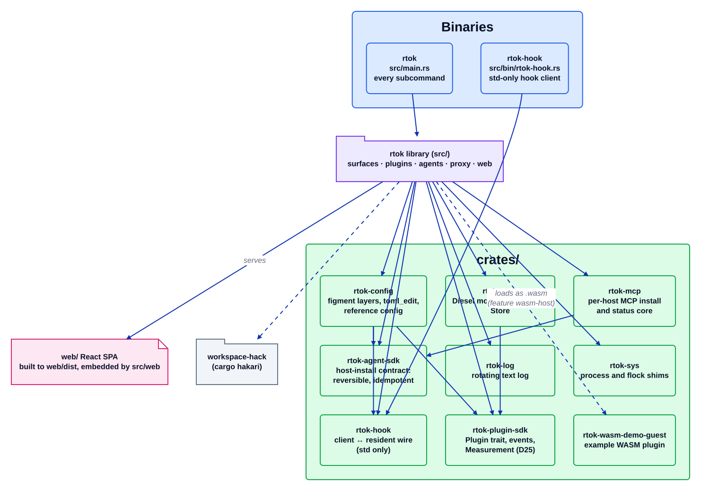

# Крейти

Джерело: [`crates.d2`](../../architecture/crates.d2). Індекс: [усі діаграми](README.md).

rtok поставляється як один пакет із двома бінарниками. Бібліотека в `src/` містить поверхні та плагіни; все, що має власний контракт або важку залежність, яка має не потрапляти в решту, живе в крейті під `crates/`.

## Покроково

1. **Два бінарники.** `rtok` (`src/main.rs`) — це кожна підкоманда. `rtok-hook` (`src/bin/rtok-hook.rs`) — клієнт лише зі std, який хост може запускати на кожен виклик хука: він звертається до резидентного `rtok hook --serve` і, якщо його немає, запускає `rtok hook` (див. [Потік хуків](hook-flow.md)). Він лінкується лише з протокольним крейтом `rtok-hook`, тож стартує швидко.
2. **Бібліотека** залежить від кожного крейта нижче і вбудовує React-панель: `web/` збирається в `web/dist` і обслуговується `src/web/spa.rs`; вона не лінкується в шлях хука.
3. **Контракти.** `rtok-plugin-sdk` — це контракт плагіна (D25), і він не залежить від жодного крейта робочого простору. `rtok-agent-sdk` — це контракт встановлення в хост: оборотні, ідемпотентні правки з резервними копіями та `--dry-run`. `rtok-hook` — протокол між клієнтом і резидентом.
4. **Власники важких залежностей.** `rtok-store` — єдиний крейт, що називає `diesel` (моделі, вбудовані міграції, `Store`). `rtok-config` відповідає за шарування figment, редагування `toml_edit` і довідкову конфігурацію. `rtok-mcp` містить логіку встановлення та статусу MCP для кожного хоста за трейтом `Fs`. `rtok-sys` містить OS-шими, яким на Windows потрібен `unsafe` (процеси, flock); `rtok-log` — це ротаційний текстовий журнал.
5. **WASM.** `rtok-wasm-demo-guest` — це приклад гостьового плагіна `no_std`, зібраного для `wasm32-unknown-unknown`; фіча `wasm-host` завантажує такі гостьові плагіни під час виконання (див. [wasm](plugins/wasm.md)).
6. **`workspace-hack`** генерується командою `cargo hakari`, щоб уніфікація фіч була однаковою для кожного учасника; так інкрементальні збірки не перекомпільовують спільні залежності.

## Де це живе

| Блок | Код |
| --- | --- |
| Робочий простір і бінарники | `Cargo.toml` (`[workspace]`, `[[bin]]`) |
| Крейти | `crates/<name>/` |
| Панель | `web/`, `src/web/spa.rs` |
| Перевірки власників залежностей | `tests/deps.rs` |
| Конфігурація hakari | `.config/hakari.toml`, `workspace-hack/` |

## Інваріанти

- `rtok-plugin-sdk` не залежить від жодного крейта робочого простору; `rtok-hook` — лише std.
- Лише `rtok-store` називає `diesel`; нічого в `src/` цього не робить.
- `cargo build --no-default-features --features measure` збирається: жоден плагін не потребує іншого.

## Пов'язане

[Огляд](overview.md) · [Шари](layers.md) · [Контракт плагіна](plugin-contract.md) · [Сховище](store.md)
