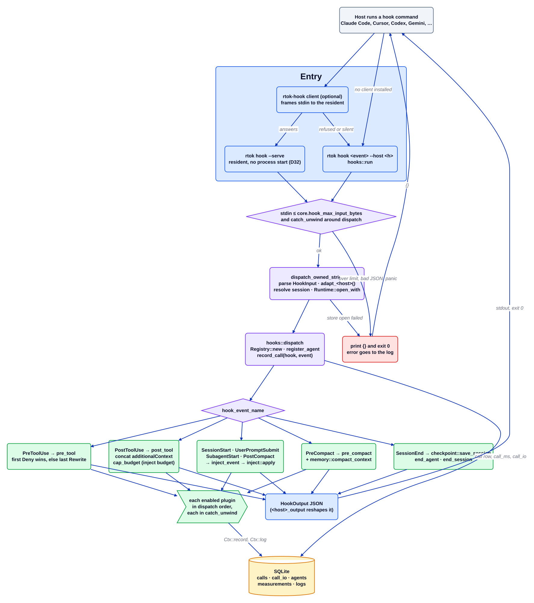

# Потік хуків

Джерело: [`hook-flow.d2`](../../architecture/hook-flow.d2). Індекс: [усі діаграми](README.md).

Хост запускає `rtok hook <event>` один раз на кожну подію хука, з JSON події на stdin. rtok читає його, дає кожному увімкненому плагіну відреагувати, зливає те, що вони повертають, в один об'єкт JSON у формі, яку очікує хост, на stdout і завершується з кодом 0. Кожен шлях помилки друкує `{}`, тож хост продовжує роботу так, ніби rtok не встановлено (fail open, D1).

## Покроково

1. **Вхід.** Хост запускає або напряму `rtok hook <event> --host <h>` (`src/cli/hook.rs` → `hooks::run`), або легкого клієнта `rtok-hook` лише зі std, який передає виклик резидентному `rtok hook --serve` через Unix-сокет або іменований канал (`src/hooks/resident.rs`, D32). Якщо резидент відмовив або його немає, клієнт сам запускає `rtok hook`, тож резидент ніколи не потрібен. Обидва шляхи завершуються в `hooks::run`.
2. **Захист.** `hooks::run` читає не більше `core.hook_max_input_bytes` і обгортає розподіл у `catch_unwind`. Завеликий stdin, помилка читання або паніка логуються і друкують `{}`. З `hook.fail_open = false` (лише для налагодження) ті самі випадки натомість викликають паніку.
3. **Адаптація.** `dispatch_owned_strict` розбирає `HookInput` і переписує payload чужого хоста у назви полів Claude (`adapt_grok`, `adapt_cursor`, `adapt_gemini`, …), визначає ідентифікатор сесії (спочатку stdin, потім `$<core.session_env>`) і відкриває `Runtime` (конфігурація та сховище). Якщо сховище лишається заблокованим довше за очікування, виклик пропускається далі, а `SessionEnd` відкладається.
4. **Запис виклику.** `hooks::dispatch` будує `Registry`, реєструє або оновлює рядок агента цієї сесії (`register_agent`) і записує один рядок `calls` для події.
5. **Розподіл за подією.**
   - `PreToolUse` → `pre_tool`: кожен плагін може повернути `Deny` або `Rewrite`. Перший `Deny` повертає одразу; інакше перемагає останній `Rewrite` (`updatedInput`).
   - `PostToolUse` → `post_tool`: плагіни можуть лише додавати контекст. Рядки з'єднуються, очікувані повідомлення агентів ідуть першими, а `cap_budget` обрізає результат до `plugins.inject.budget_tokens`, залишаючи для відкинутого вказівник `rtok expand`.
   - `SessionStart`, `UserPromptSubmit`, `SubagentStart`, `PostCompact` → `inject_event`: кожна `Injection` (а також id агента і примітки про worktree, закріплені за агентом) передається в `inject::apply`, який упорядковує їх за пріоритетом і виводить, доки не вичерпає бюджет.
   - `PreCompact` → `pre_compact` кожного плагіна, потім `memory::compact_context` як контекст.
   - `SessionEnd` → `checkpoint::save_session`, `end_agent` (який також знімає блокування worktree агента) і `end_session`.
6. **Ізоляція плагінів.** Кожен виклик трейту виконується у власному `catch_unwind`; плагін, що панікує, логується (`log_panic`) і відкидається, а решта враховуються.
7. **Відповідь.** Злитий `HookOutput` серіалізується; `copilot_output`, `cursor_output`, `gemini_output`, `codex_output` та інші перелаштовують його для хостів з іншою обгорткою. Тривалість виклику та його stdin/stdout ідуть у `calls` / `call_io`; `Stop` і `SessionEnd` також запускають дочірній процес експорту OTLP.

## Де це живе

| Блок | Код |
| --- | --- |
| `rtok hook <event>` | `src/cli/hook.rs`, `src/hooks/mod.rs` (`run`) |
| Резидент і клієнт | `src/hooks/resident.rs`, `crates/rtok-hook/` |
| Адаптація | `src/hooks/mod.rs` (`dispatch_owned_strict`), `src/hooks/types.rs` (`HookInput::adapt_*`) |
| Розподіл | `src/hooks/mod.rs` (`dispatch`, `pre_tool`, `post_tool`, `inject_event`, `cap_budget`) |
| Повідомлення агентів, передані в контекст | `src/hooks/push.rs` |
| Бюджет ін'єкцій | `src/plugins/inject/` (`apply`) |
| Журнал | `crates/rtok-store/` (`record_call`, `insert_hook_call_io`, `register_agent`) |

## Інваріанти

- Вихід із кодом 0 у межах бюджету 10 мс на кожному шляху; хук ніколи не блокує агента.
- PostToolUse лише додає контекст; результат інструмента не можна замінити з хука в Claude Code.
- Паніка одного плагіна ніколи не прибирає вивід іншого плагіна.
- Повторна доставка одного виклику інструмента (хук плагіна плюс залишений хук у налаштуваннях) записується один раз: `Runtime::once` ключує вимірювання за `<event>:<tool_use_id>`.

## Пов'язане

[Огляд](overview.md) · [Контракт плагіна](plugin-contract.md) · [Сховище](store.md) · [inject](plugins/inject.md) · [cmd](plugins/cmd.md) · [Потік MCP](mcp-flow.md) · [Потік проксі](proxy-flow.md)
