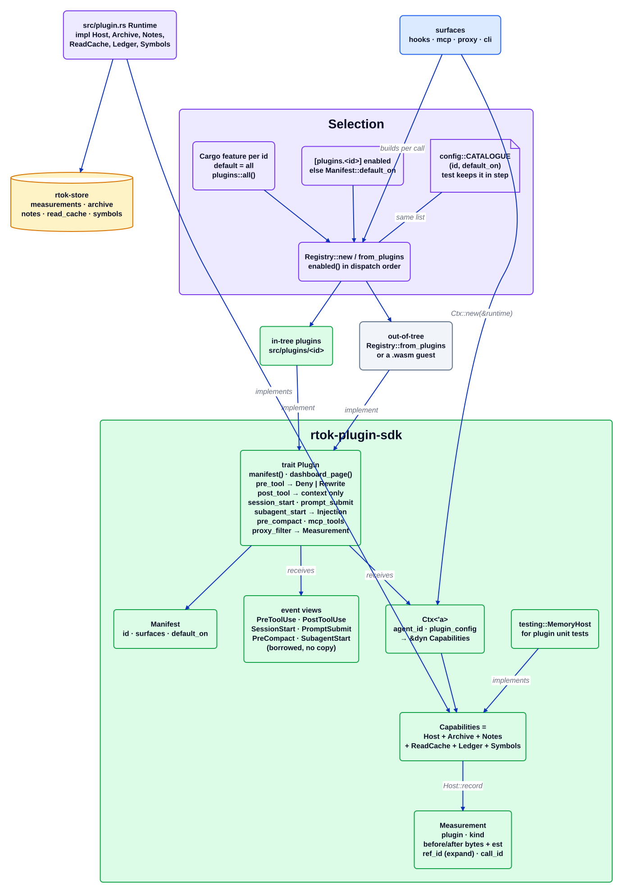

# Контракт плагіна

Джерело: [`plugin-contract.d2`](../../architecture/plugin-contract.d2). Індекс: [усі діаграми](README.md).

Кожен метод скорочення токенів у rtok — це плагін за одним трейтом. Трейт і кожен тип, який називає плагін, живуть у `crates/rtok-plugin-sdk` (D25), тож плагін, вбудований у репозиторій чи ні, залежить від контракту, а не від бінарника rtok. Хостова частина, `Runtime` у `src/plugin.rs`, реалізує трейти можливостей, яких вимагає контракт.

## Покроково

1. **Вибір під час компіляції.** Кожен id плагіна — це фіча Cargo (`default = all`), а `plugins::all()` додає кожен під `#[cfg(feature = "<id>")]` у порядку розподілу.
2. **Вибір під час виконання.** `Registry::new(&config)` пов'язує кожен скомпільований плагін із `config.plugin_enabled(id, default_on)`: `[plugins.<id>] enabled`, якщо його задано, інакше `default_on` з маніфесту. `config::CATALOGUE` перелічує ті самі пари `(id, default_on)`, і тест падає, якщо вони розходяться, тож плагін не можна зареєструвати наполовину.
3. **Трейт.** `manifest()` і `dashboard_page()` обов'язкові. Кожен метод події має порожню реалізацію за замовчуванням, тож плагін пише лише те, що оголошує в `Manifest::surfaces`: `pre_tool` може повернути `Deny` або `Rewrite` для виклику; `post_tool` повертає додатковий контекст і більше нічого; `session_start`, `prompt_submit` і `subagent_start` повертають `Injection` (текст + пріоритет), який бюджетує `inject`; `pre_compact` виконується перед стисненням (compaction); `mcp_tools` оголошує інструменти MCP; `proxy_filter` редагує `WireRequest` і повертає `Measurement`.
4. **Події — це позичені подання** поверх розібраного вхідного JSON хука (`PreToolUse<'a>`, …), тож шлях хука нічого не копіює.
5. **`Ctx` — це весь світ плагіна.** Він несе id агента і типізовану конфігурацію плагіна (`plugin_config::<T>(id)`) і розгортається (deref) до `&dyn Capabilities`: `Host` (сесія, cwd, `estimate`, `record`, `log`, конфігурація), `Archive` (зберігає оригінали для `expand`), `Notes` (пам'ять), `ReadCache`, `Ledger` і `Symbols` (індекс графа).
6. **Економія — це `Measurement`.** `Host::record` — єдиний спосіб заявити про економію: плагін, вид, байти та оцінені токени до і після, `ref_id`, який розв'язує `expand`, і власний `call_id`.
7. **Дві реалізації хоста.** `Runtime` реалізує кожну можливість поверх `rtok-store`; `testing::MemoryHost` реалізує їх у пам'яті для юніт-тестів плагінів.
8. **Поза репозиторієм.** Крейт, що вбудовує rtok, передає власні плагіни в `Registry::from_plugins`; з фічею `wasm-host` WASM-гості додаються до реєстру під час виконання.

## Де це живе

| Блок | Код |
| --- | --- |
| Трейт, події, `Manifest`, `Measurement`, `Injection` | `crates/rtok-plugin-sdk/src/lib.rs` |
| `Ctx` і трейти можливостей | `crates/rtok-plugin-sdk/src/host.rs` |
| `WireRequest` для `proxy_filter` | `crates/rtok-plugin-sdk/src/wire.rs` |
| Хост у пам'яті | `crates/rtok-plugin-sdk/src/testing.rs` (`MemoryHost`) |
| Рантайм хоста | `src/plugin.rs` (`Runtime`, `impl Host`, `impl Archive`, …) |
| Реєстр | `src/plugins/mod.rs` (`all`, `Registry`) |
| Каталог | `crates/rtok-config/` (`CATALOGUE`) |
| Посібник для авторів | `docs/plugin-authoring.md`, `examples/hello_plugin.rs` |

## Інваріанти

- Паніка плагіна перехоплюється поверхнею і відкидає лише вивід цього плагіна.
- PostToolUse повертає лише контекст; тип не має способу замінити результат інструмента.
- Жоден плагін не залежить від іншого: `cargo build --no-default-features --features measure` збирається.
- Відсутність рядка `Measurement` означає відсутність заяви про економію — у коді, документації чи звітах.

## Пов'язане

[Огляд](overview.md) · [Потік хуків](hook-flow.md) · [Сховище](store.md) · [`docs/plugin-authoring.md`](../plugin-authoring.md) · [wasm](plugins/wasm.md)
