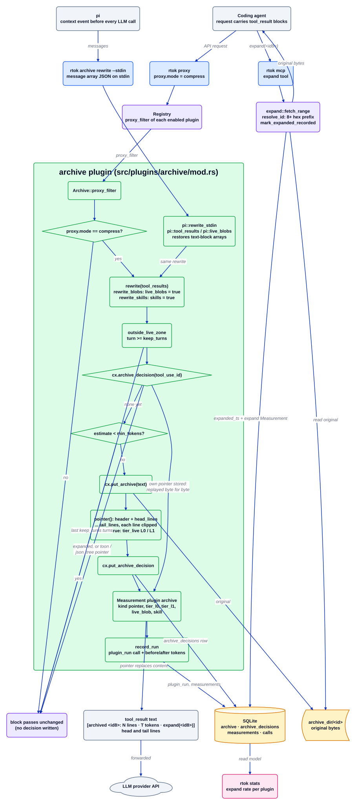

# Плагін archive

Джерело: [`archive.d2`](../../../architecture/plugins/archive.d2). Документація плагіна: [README](../../../../src/plugins/archive/README.md). Індекс: [усі діаграми](../README.md).

`archive` зменшує результати інструментів, які вийшли з живої зони: результати старші за
`keep_turns` ходів і більші за `min_tokens`. Оригінал іде до сховища архіву, а блок, який
бачить модель, стає рядком-вказівником плюс перший і останній рядки оригіналу. Рішення
зберігається для кожного `tool_use_id`, тож кожен наступний запит відтворює ті самі байти,
і кеш промптів провайдера лишається дійсним.

## Покроково

1. **Носій передає запит.** У `proxy.mode = "compress"` проксі викликає `Plugin::proxy_filter`
   кожного ввімкненого плагіна; `Archive::proxy_filter` повертається одразу, якщо режим не
   `compress`. Без проксі pi спрацьовує своєю подією `context`, а розширення викликає
   `rtok archive rewrite --stdin`, який запускає `archive::pi::rewrite_stdin`. Обидва носії
   використовують одні й ті самі функції `rewrite` і `rewrite_blobs`; `pi::tool_results` і
   `pi::live_blobs` лише подають масив повідомлень pi у нормалізованому для дроту вигляді
   (`ToolResultRef`, `BlobRef`).
2. **Вибір смуг.** `rewrite(req.tool_results(), cx)` виконується завжди. `rewrite_blobs`
   виконується лише тоді, коли `[plugins.archive] live_blobs` має значення true, а
   `rewrite_skills` лише тоді, коли `skills` має значення true; обидві опції вимкнені за
   замовчуванням.
3. **Лишатися поза живою зоною.** `outside_live_zone` відкидає кожен результат, чий `turn`
   менший за `keep_turns`. `toon` викликає ту саму функцію, тож межа визначається в одному місці.
4. **Пошук попереднього рішення.** `rewrite_block` викликає `cx.archive_decision(tool_use_id)`.
   Розгорнутий id або рядок, чий вказівник починається з префікса `toon` чи `json_tree`, не
   чіпається (ці плагіни ділять таблицю `archive_decisions` і вже виміряли власну економію).
   Будь-який інший збережений вказівник відтворюється як є і вимірюється знову.
5. **Перевірка розміру.** Якщо рішення ще немає, `cx.estimate(text, Class::Code)` менше за
   `min_tokens` залишає блок без змін і нічого не записує.
6. **Архів і запис вказівника.** `cx.put_archive` зберігає оригінальні байти. `pointer()`
   формує `[archived <id8>: N lines · T tokens · expand(<id8>)]`, після якого йдуть `head_lines`
   і `tail_lines` оригіналу, кожен рядок обрізано через `clip`. Коли `tiers = true`, `tier_live`
   виводить лише рядок вказівника (L0) і додає без втрат витяг (L1) для результатів рівно на
   ходи `keep_turns`.
7. **Збереження рішення.** `cx.put_archive_decision` зберігає текст вказівника до того, як запит
   буде переслано далі. Помилка сховища на будь-якому кроці залишає блок без змін.
8. **Вимірювання.** Кожен переписаний блок дає `Measurement` (`plugin: "archive"`, вид
   `pointer`, `tier_l0`, `tier_l1`, `live_blob` або `skill`). `record_run` записує їх в одному
   виклику `plugin_run` з оцінками токенів `before` і `after`.
9. **Розгортання.** Модель викликає інструмент MCP `expand` із 8-символьним id. `expand::fetch_range`
   розв'язує префікс, читає оригінал з архіву, встановлює `expanded_ts` і записує вимірювання
   `expand` в одній транзакції. Починаючи з наступного запиту, `rewrite_block` бачить розгорнуте
   рішення і не чіпає оригінальний текст.

## Де це живе

| Блок | Код |
| --- | --- |
| `Archive::proxy_filter`, перевірка режиму | `src/plugins/archive/mod.rs` (`Archive`, `proxy_filter`) |
| носій pi | `src/plugins/archive/pi.rs` (`rewrite_stdin`, `tool_results`, `live_blobs`); `src/cli/archive.rs` |
| Смуги | `src/plugins/archive/mod.rs` (`rewrite`, `rewrite_blobs`, `rewrite_skills`) |
| Межа живої зони | `src/plugins/archive/mod.rs` (`outside_live_zone`) |
| Рішення, перевірка розміру | `src/plugins/archive/mod.rs` (`rewrite_block`, `rewrite_blob`, `rewrite_skill`) |
| Текст вказівника | `src/plugins/archive/mod.rs` (`pointer`, `pointer_line`, `clip`, `tier_live`, `l1_extract`) |
| Вимірювання і рядок запуску | `src/plugins/archive/mod.rs` (`record_run`) |
| `expand` | `src/expand.rs` (`fetch_range`, `resolve_id`); `src/mcp.rs` (`expand_text`) |
| Таблиці | `crates/rtok-store/src/schema.rs` (`archive`, `archive_decisions`, `measurements`) |
| Конфігурація | `crates/rtok-config/src/lib.rs` (секція `Archive`: `keep_turns`, `min_tokens`, `head_lines`, `tail_lines`, `tiers`, `live_blobs`, `skills`) |

## Інваріанти

- Без втрат: оригінал зберігається до того, як блок змінюється, і `expand <id>` його повертає.
- Детермінованість: текст вказівника зберігається для кожного `tool_use_id` (blob-и: для кожного
  хешу вмісту), тож повтор байт-в-байт ідентичний і префікс промпту не зсувається.
- Ніколи не чіпаються: `system`, `tools`, останні `keep_turns` ходів, розгорнутий id і
  зображення або інші нетекстові частини (`block_text` повертає `None` для них).
- Відмовостійкість: будь-яка помилка сховища залишає блок таким, яким він був.
- Одне `Measurement` на кожен переписаний блок; немає рядка, немає заяви про економію.
- `live_blobs`, `skills` і `tiers` є опційними і за замовчуванням мають значення false.

## Пов'язане

[Огляд](../overview.md) · [Контракт плагіна](../plugin-contract.md) ·
[proxy](proxy.md) · [toon](toon.md) · [compress](compress.md) · [cmd](cmd.md)
