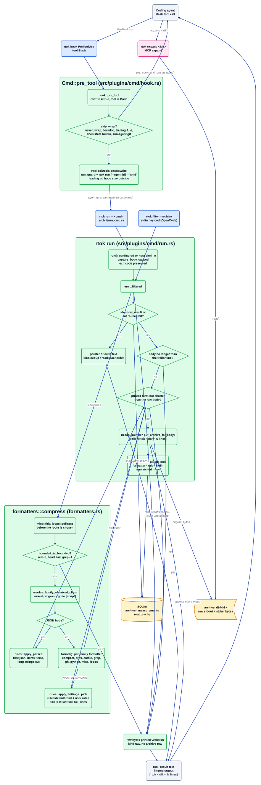

# Плагін cmd

Джерело: [`cmd.d2`](../../../architecture/plugins/cmd.d2). Документація плагіна: [README](../../../../src/plugins/cmd/README.md). Індекс: [усі діаграми](../README.md).

`cmd` скорочує те, що друкує виклик інструмента Bash. Хук `PreToolUse` переписує команду так,
щоб вона виконувалася через `rtok run`; цей процес перехоплює stdout і stderr, фільтрує їх
форматувальником для конкретної родини або правилом TOML, архівує сирі байти, якщо щось було
відкинуто, і друкує результат із однорядковим завершальним рядком, який називає id архіву.
Код виходу загорнутої команди зберігається.

## Покроково

1. **Хук бачить виклик Bash.** `CmdPlugin::pre_tool` викликає `hook::pre_tool`, який повертається
   одразу, якщо інструмент не `Bash` або `[plugins.cmd] rewrite` не має значення true. Шлях
   хука не обходить файлову систему і не запускає підпроцеси.
2. **Вирішити, чи загортати.** `skip_wrap_host` відмовляє команді, перше слово якої є в
   `never_wrap` (за замовчуванням `rtok`, `sudo`), команді з heredoc (`<<`), кінцевим `&`,
   `--interactive` або `-i` для стему зі списку `interactive_stems`. `changes_shell_state`
   відмовляє `cd`, `export`, `source` та іншим вбудованим командам, чий ефект загубиться в
   дочірній оболонці, а також голому присвоєнню. Команда субагента, яка викликає `git`, ніколи
   не загортається (`runs_git`). Початкові переходи `cd <dir> &&` відокремлює
   `guard::strip_cd_hop` і вони лишаються поза обгорткою.
3. **Переписати.** Хук повертає `PreToolDecision::Rewrite` із текстом
   `<run_guard>rtok run [--agent <id>] -- '<cmd>'`. Охоронець (`names::run_guard`) змушує
   POSIX-оболонку хоста виконати оригінальну команду, якщо `rtok` немає в її `PATH`. `--agent`
   несе перевірений id субагента, щоб вказівники дедуплікації лишалися в межах одного контексту.
4. **Виконання.** `run::run` вибирає оболонку (`[plugins.cmd] shell`, потім середовище, потім
   типова для хоста), запускає команду через `capture_body`, який обмежує захоплені байти й
   додає повідомлення, коли обрізає, і зберігає код виходу. `rtok filter --archive` (OpenCode)
   входить одразу в `emit_filtered` із готовим корисним навантаженням.
5. **Друк сирого виводу або посилання на попередній результат.** `emit_filtered` друкує байти
   без змін, якщо команда є `rtok expand` або сховище не відкривається. Інакше
   `identical_result` замінює побайтово ідентичне тіло з тієї самої сесії однорядковим
   вказівником, а для `cat` файлу, який читали раніше, `read::cache::hit` повертає вказівник або
   diff. `identical_result` записує вимірювання `dedup`.
6. **Пропуск крихітних тіл.** Тіло, не довше за свій завершальний рядок, друкується без змін і
   записує вимірювання `raw` з однаковими байтами до і після.
7. **Стиснення.** `formatters::compress` спершу прибирає шум `mise` і згортає цикли опитування
   (`mise::tidy`, `loops::collapse`). Далі `compress_text` пропускає без змін команду, яку агент
   вже обмежив (`bounded::is_bounded`: `sed -n`, `head`, `tail -n`, `grep -A/-B/-C/-m`).
   `resolve` вибирає родину; ланцюжок із двох або більше різних програм (`bounded::mixed_chain`)
   іде до правила `[script]`.
8. **Вибрати фільтр.** Тіло JSON іде до `rules::apply_parsed`. Інакше `format()` вибирає
   форматувальник за програмою і підкомандою (`cargo`, `git`, `ls -l`, `cat`, `grep`/`rg`, `gh`,
   `pytest`, `python`, `docker ps`, `kubectl get`, `mise` та інші в `compact.rs`, `diffs.rs`,
   `catfile.rs`, `grep.rs`, `gh.rs`, `python.rs`). Якщо форматувальника немає, `rules::apply`
   використовує правило, яке `Settings::pick` обирає з `rules/default.toml` і файлів користувача
   `rules` та `rules_dir`: шаблони відкидання й збереження (рядки з error, warning, panic, fail і
   traceback завжди лишаються), дедуплікація, групування, потім обрізання з початку й кінця з
   позначкою `… N lines omitted (expand <id>)`. Ненульовий код виходу зберігає останні
   `fail_tail_lines` рядків дослівно.
9. **Ніколи не гірше за сирий вивід.** Коректний UTF-8, який фільтр не скоротив (на рівні або
   нижче `trailer_min_lines` рядків), або чия друкована форма (відфільтрований текст плюс
   завершальний рядок) не коротша за сире тіло, друкується як сирі байти з вимірюванням `raw`.
10. **Архів і завершальний рядок.** `needs_pointer` вирішує, чи потрібен завершальний рядок:
    більше `trailer_min_lines` рядків або скорочення, яке відкинуло щось, що читач міг пропустити.
    Лише згортання пробілів або видалення ANSI-кольорів не потребує його. Коли є вказівник або
    вбудований маркер `expand <id>`, `put_archive_for(body)` зберігає сирі байти (а не втратний
    UTF-8-вигляд), і вивід закінчується рядком `[rtok <id8> · N lines]`.
11. **Вимірювання.** Одне `Measurement` (`plugin: "cmd"`) записує видимі хосту байти до і після
    з видом `formatter`, `rule`, `skill`, `unmatched` або `raw`. `ref_id` має вигляд
    `<family>:<id>`, коли існує рядок архіву.
12. **Розгортання.** Модель виконує `rtok expand <id8>` (або інструмент MCP `expand`) і отримує
    оригінальні байти. Цей вивід ніколи не дедуплікується і не скорочується знову.

## Де це живе

| Блок | Код |
| --- | --- |
| `CmdPlugin::pre_tool` і шлюз обгортання | `src/plugins/cmd/hook.rs` (`pre_tool`, `skip_wrap_host`, `changes_shell_state`) |
| Текст переписування | `src/plugins/cmd/run.rs` (`wrap_quote`), `src/names.rs` (`run_guard`) |
| `rtok run` | `src/plugins/cmd/run.rs` (`run`, `capture_body`); `src/cli/run_cmd.rs` |
| `rtok filter --archive` | `src/cli/run_cmd.rs` (`filter`) |
| `emit_filtered`, завершальний рядок | `src/plugins/cmd/run.rs` (`emit_filtered`, `needs_pointer`, `trailer`) |
| Дедуплікація і повторне читання | `src/plugin.rs` (`identical_result`); `src/plugins/cmd/catfile.rs` (`reread_key`); `src/plugins/read/cache.rs` |
| Маршрут і вибір фільтра | `src/plugins/cmd/formatters.rs` (`compress`, `compress_text`, `format`, `family_of`) |
| Обмежені команди, змішані ланцюжки | `src/plugins/cmd/bounded.rs` (`is_bounded`, `mixed_chain`) |
| Форматувальники | `src/plugins/cmd/compact.rs`, `diffs.rs`, `catfile.rs`, `grep.rs`, `gh.rs`, `python.rs`, `mise.rs`, `loops.rs` |
| Правила | `src/plugins/cmd/rules.rs` (`Settings`, `apply`, `apply_parsed`), `src/plugins/cmd/logfmt.rs`, `rules/default.toml` |
| `expand` | `src/expand.rs` (`fetch_range`) |
| Конфігурація | `crates/rtok-config/src/lib.rs` (секція `Cmd`) |

## Інваріанти

- Без втрат: усе, що читач міг би пропустити, архівується до відкидання, а `expand <id>`
  повертає сирі байти, зокрема невалідний UTF-8.
- Код виходу загорнутої команди зберігається точно.
- Ніщо не редагується.
- Відмовостійкість: якщо сховище не відкривається або запис архіву падає, друкуються власні
  байти команди.
- Шлях хука лишається в межах свого бюджету 10 мс: без обходу файлової системи і без підпроцесів.
- Оболонка розбирається лише до першого слова argv, за винятком `bounded.rs`, який лексує лапки
  і роздільники `|`, `&&`, `||`, `;`.
- Кожен запуск записує одне `Measurement`; немає рядка, немає заяви про економію.

## Пов'язане

[Огляд](../overview.md) · [Контракт плагіна](../plugin-contract.md) ·
[Потік хуків](../hook-flow.md) · [archive](archive.md) · [guard](guard.md) · [read](read.md) ·
[toon](toon.md)
