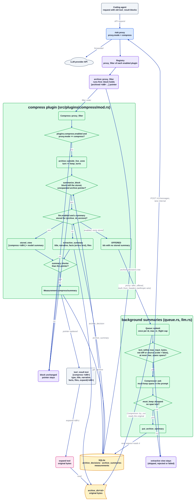

# Плагін compress

Джерело: [`compress.d2`](../../../architecture/plugins/compress.d2). Нотатки плагіна: [PLAN](../../../../src/plugins/compress/PLAN.md) (у цього плагіна немає README). Індекс: [усі діаграми](../README.md).

`compress` робить один крок далі, ніж `archive`, для блоків, які `archive` уже замінив
вказівником. У `proxy.mode = "compress"` він замінює вказівник коротким структурованим
поданням (тип, заголовок, оповідь, факти, файли), яке будується без моделі. За бажанням
фонова черга один раз просить модель скласти кращий підсумок, зберігає його, і пізніші запити
показують саме його. Оригінал лишається в архіві, а подання завжди закінчується на
`expand(<id8>)`.

## Покроково

1. **Запуск після archive.** Проксі запускає `proxy_filter` кожного ввімкненого плагіна над
   розібраним запитом. `archive` працює першим і лишає вказівники `[archived <id8>: ...]` у
   старих результатах інструментів; далі `CompressPlugin::proxy_filter` повертається одразу, якщо
   `[plugins.compress] enabled` не має значення true або `proxy.mode` не є `compress`.
2. **Лишатися поза живою зоною.** `compress::rewrite` повторно використовує
   `archive::outside_live_zone`, тож останні `[plugins.archive] keep_turns` ходів ніколи не
   чіпаються.
3. **Перевірити блок.** `summarize_block` читає `cx.archive_decision(tool_use_id)`. Він
   продовжує роботу лише тоді, коли рішення існує, не розгорнуте, його вказівник починається з
   `[archived `, а текст блока досі дорівнює збереженому вказівнику. Усе інше лишається без змін.
4. **Вибрати подання.** Коли ввімкнено `[plugins.compress.llm] enabled` і для цього
   `(archive_id, version)` у `archive_summaries` збережено підсумок, `stored_view` будує
   `[compress <id8>]`, `type: tool_output`, `summary: ...`, `expand(<id8>)`. Інакше
   `extractive_summary` читає оригінал через `cx.get_archive` і будує заголовок, оповідь з трьох
   наступних різних рядків, до трьох фактів (спершу рядки помилок) і до трьох рядків файлів;
   рядки фактів і файлів обрізаються через `archive::clip`.
5. **Запропонувати id.** Коли прапорець LLM увімкнено, а підсумку ще немає, id архіву додається
   до thread-local списку `OFFERED`, а блок лишається з екстрактивним поданням.
6. **Лишати лише економію.** Подання, яке не коротше за вказівник, відкидається, і вказівник
   лишається. Інакше текст блока замінюється, і повертається `Measurement`
   (`plugin: "compress"`, вид `summary`).
7. **Передати id черзі.** Після фільтрів проксі вичерпує `take_offered()` і, якщо існує
   `state.summaries`, викликає `Queue::submit` з `Auth::from_headers`, який повертає облікові
   дані лише для дроту Anthropic. Виклик повертається одразу.
8. **Підсумовування у фоні.** `Queue::admit` займає слот виконання (`max_in_flight`) і пробує кожен
   id один раз за процес. `Compressor::try_run` пропускає id, що є в кеші, нетекстове
   навантаження, те, що більше за `max_input_bytes`, diff або вихідний код, якщо не задано
   `code = true`, і блок із більш ніж `max_spans` спанами, які треба зберегти.
9. **Запит і перевірка.** `Compressor::ask` надсилає один запит `/v1/messages` на власну адресу
   проксі (або на `[plugins.compress.llm] url`) із заголовком смуги `internal`, щоб витрати
   були позначені, а `[proxy.routing]` застосувався. `must_keep::dropped` перевіряє, що підсумок
   досі містить кожен спан (шляхи, ідентифікатори, коди помилок, числа, команди, id); підсумок,
   який порожній, не коротший за оригінал або втратив спан, не зберігається.
10. **Збереження.** `put_archive_summary` записує підсумок поруч із рядком архіву. Він ніколи
    не змінюється потім, тож подання є стабільним за байтами від ходу, на якому з'явилося.
11. **Розгортання.** `expand(<id8>)` повертає оригінальні байти, а розгорнуте рішення зупиняє
    `compress` від переписування цього блока.

## Де це живе

| Блок | Код |
| --- | --- |
| `CompressPlugin::proxy_filter` | `src/plugins/compress/mod.rs` (`CompressPlugin`, `proxy_filter`) |
| `archive::proxy_filter`, `outside_live_zone` | `src/plugins/archive/mod.rs` |
| `summarize_block`, `stored_view` | `src/plugins/compress/mod.rs` |
| `extractive_summary` | `src/plugins/compress/mod.rs` (використовує `archive::clip`) |
| `OFFERED`, `take_offered` | `src/plugins/compress/mod.rs`; вичерпуються в `src/proxy/mod.rs` |
| Черга | `src/plugins/compress/queue.rs` (`Queue`, `submit`, `admit`) |
| Клієнт компресора | `src/plugins/compress/llm.rs` (`Compressor`, `Auth`, `version`, `is_code`); промпт у `prompt.toml` |
| Спани, які треба зберегти | `src/plugins/compress/must_keep.rs` (`spans`, `dropped`) |
| Таблиці | `crates/rtok-store/src/schema.rs` (`archive_decisions`, `archive_summaries`, `measurements`) |
| Конфігурація | `crates/rtok-config/src/lib.rs` (`Compress`, `CompressLlm`) |

## Інваріанти

- Без втрат: рядок архіву, записаний `archive`, не змінюється, а `expand <id>` завжди повертає
  оригінальні байти.
- Детермінованість: витягувальне подання є чистою функцією від архівованого тексту, а збережений
  підсумок моделі ніколи не змінюється, тож повторений запит ідентичний за байтами.
- `[plugins.compress.llm]` вимкнено за замовчуванням; коли він вимкнений, клієнта і черги не існує.
- Підсумок моделі зберігається лише тоді, коли він зберігає кожен спан оригіналу, який треба
  зберегти.
- Виклик моделі йде через смугу `internal` проксі, і лише облікові дані дроту Anthropic
  пересилаються туди.
- Будь-яка помилка читання сховища або архіву залишає блок без змін; кожна економія є
  `Measurement`, а немає рядка означає відсутність заяви.

## Пов'язане

[Огляд](../overview.md) · [Контракт плагіна](../plugin-contract.md) ·
[archive](archive.md) · [proxy](proxy.md) · [toon](toon.md)
