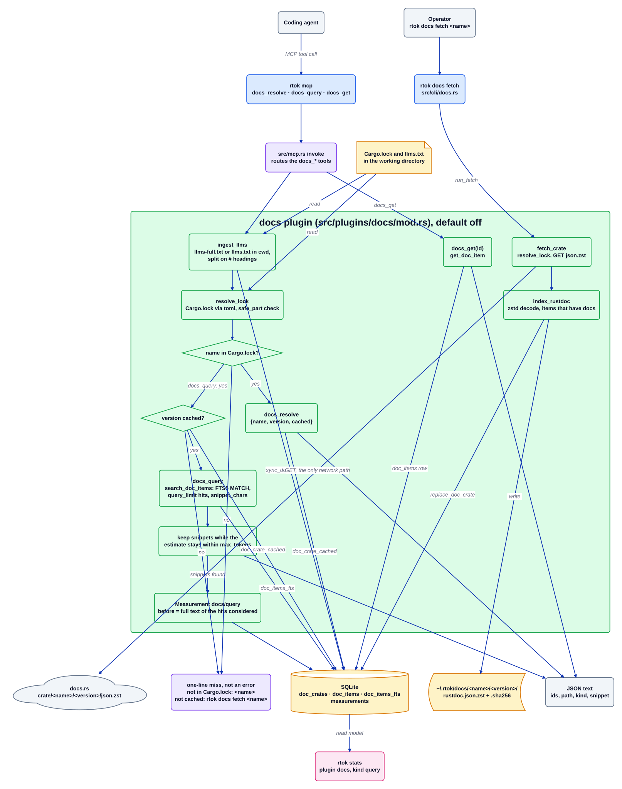

# Плагін docs

Джерело: [`docs.d2`](../../../architecture/plugins/docs.d2). Документація плагіна: [README](../../../../src/plugins/docs/README.md). Індекс: [усі діаграми](../README.md).

`docs` дає агенту документацію саме тієї версії крейта, з якою збирається проєкт, без
вставляння цілих сторінок у розмову. Три інструменти MCP визначають залежність за `Cargo.lock`,
повертають ранжовані фрагменти з кешованого індексу rustdoc docs.rs і за запитом завантажують
тіло одного елемента. Плагін вимкнений за замовчуванням (`[plugins.docs] enabled = false`) і не
має методів хуків.

## Покроково

1. **Надходить виклик інструмента.** Агент викликає `docs_resolve`, `docs_query` або `docs_get`
   у `rtok mcp`. `src/mcp.rs` спрямовує кожне ім'я до відповідної функції в
   `src/plugins/docs/mod.rs`.
2. **Підбір нотаток робочого простору.** `docs_resolve` і `docs_query` спершу виконують
   `ingest_llms`: файл `llms-full.txt` або `llms.txt` у робочому каталозі ділиться за заголовками
   `#` на псевдокрейт `llms`, який записується під версією `local:<cwd>`, щоб робочі простори
   не бачили тексту одне одного. Незмінені байти нічого не чіпають; відсутній або порожній файл
   скидає кеш цього робочого простору.
3. **Визначення.** `resolve_lock` читає `Cargo.lock` з робочого каталогу через крейт `toml`
   (без підпроцесу `cargo`) і повертає перший пакет із цим іменем. Ім'я та версія мають пройти
   `safe_part`, бо обидва потрапляють у URL і шлях кешу. `docs_resolve` відповідає
   `{name, version, cached}`, де `cached` береться з `doc_crate_cached`.
4. **Промах без помилки.** Ім'я, якого немає в `Cargo.lock`, дає `not in Cargo.lock:
   <name>`; версія крейта, якої немає в сховищі, дає `not cached: rtok docs fetch <name>`. Обидві
   є звичайними однорядковими результатами.
5. **Запит.** Для кешованої версії `docs_query` викликає `search_doc_items`, тобто FTS5
   `MATCH` по `doc_items_fts`, обмежений `query_limit` влученнями з `snippet_chars` на фрагмент.
   Потім він по одному залишає фрагменти, доки оцінка токенів JSON лишається в межах
   `max_tokens`. Сокет не відкривається.
6. **Вимірювання.** Коли повертається принаймні один фрагмент, `docs_query` записує
   `Measurement` (`plugin: "docs"`, вид `query`, `ref_id` `<name>@<version>`), у якого сторона
   `before` є повним текстом кожного розглянутого влучання.
7. **Завантаження одного елемента.** `docs_get(id)` повертає шлях, вид і повний текст документації
   одного кешованого елемента з `doc_items` або завершується помилкою `unknown doc id`.
8. **Завантаження лише на запит.** `rtok docs fetch <name>` викликає `run_fetch`, який визначає
   версію з `Cargo.lock`, виконує GET на `https://docs.rs/crate/<name>/<version>/json.zst` через
   `http_get`, декодує потік zstd, а `index_rustdoc` зберігає кожен елемент, що має рядок
   документації. Стиснутий файл і його sha256 записуються в `<home>/docs/<name>/<version>/`, а
   `replace_doc_crate` наповнює `doc_crates` і `doc_items`; тригер бази даних підтримує
   `doc_items_fts` в актуальному стані.

## Де це живе

| Блок | Код |
| --- | --- |
| Маршрутизація MCP | `src/mcp.rs` (`invoke`, `docs_resolve`, `docs_query`, `docs_get`) |
| Визначення інструментів | `src/plugins/docs/mod.rs` (`DocsPlugin::mcp_tools`) |
| `ingest_llms` | `src/plugins/docs/mod.rs` (`ingest_llms`, `split_llms`, `local_version`) |
| `resolve_lock` | `src/plugins/docs/mod.rs` (`resolve_lock`, `safe_part`) |
| Запит і бюджет | `src/plugins/docs/mod.rs` (`docs_query`); `crates/rtok-store/src/docs.rs` (`search_doc_items`) |
| `docs_get` | `src/plugins/docs/mod.rs` (`docs_get`); `crates/rtok-store/src/docs.rs` (`get_doc_item`) |
| Завантаження | `src/cli/docs.rs`; `src/plugins/docs/mod.rs` (`run_fetch`, `fetch_crate`, `http_get`, `index_rustdoc`) |
| Таблиці | `crates/rtok-store/src/schema.rs` (`doc_crates`, `doc_items`); міграція `0039_docs_fts` (`doc_items_fts`) |
| Конфігурація | `crates/rtok-config/src/lib.rs` (`Docs`: `enabled`, `query_limit`, `snippet_chars`, `max_tokens`) |

## Інваріанти

- Вимкнено за замовчуванням і без методів хуків: SessionStart, PreCompact і подання промпту
  лишаються без змін.
- `docs_resolve`, `docs_query` і `docs_get` ніколи не відкривають сокет; єдиний мережевий шлях
  дає `rtok docs fetch`.
- Ім'я або версія крейта, які не є безпечними для шляху, ніколи не використовуються для побудови
  URL чи шляху до файлу.
- Невідомий крейт є однорядковим промахом, а не помилковим завершенням.
- Запит, що повертає фрагменти, записує `docs`/`query`; без рядка немає заяви про економію.
- SQL сховища живе в `crates/rtok-store/src/docs.rs`; таблиця FTS5 є віртуальною таблицею, яку
  DSL Diesel не може змоделювати.

## Пов'язане

[Огляд](../overview.md) · [Контракт плагіна](../plugin-contract.md) ·
[Потік MCP](../mcp-flow.md) · [read](read.md) · [memory](memory.md)
