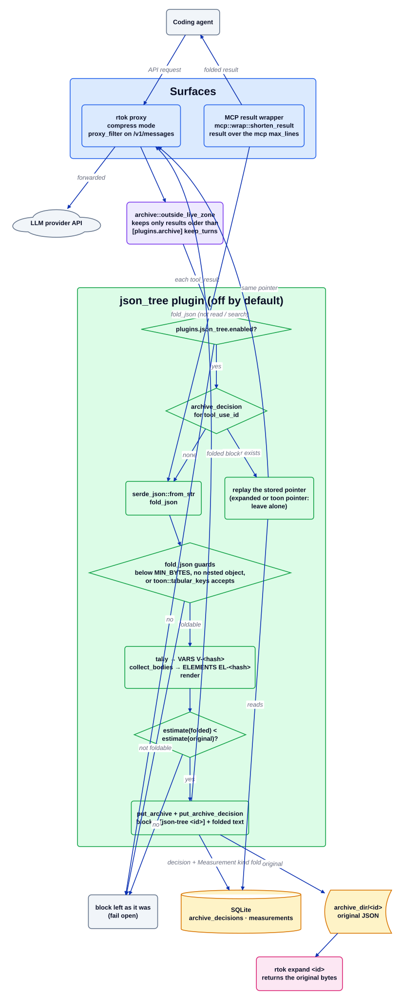

# Плагін json_tree

Джерело: [`json_tree.d2`](../../../architecture/plugins/json_tree.d2). Документація плагіна: [README](../../../../src/plugins/json_tree/README.md). Індекс: [усі діаграми](../README.md).

`json_tree` зменшує великий вкладений JSON (дизайнерський файл, AST, глибока відповідь API), не
відрізаючи його. Значення, які використовують два або більше об'єктів, друкуються один раз під
`VARS:`, а повторювані тіла об'єктів стають шаблонами `EL-`, тож модель бачить структуру без
повторів, а не початок і кінець архіву. Плагін вимкнений за замовчуванням і переписує блок лише
тоді, коли згортання оцінюється дешевшим за JSON, який воно замінює.

## Покроково

1. **Дві точки входу.** У режимі `compress` проксі викликає `JsonTreePlugin::proxy_filter` для кожного
   запиту. Окремо `mcp::wrap::shorten_result` (`src/mcp/wrap.rs`) викликає `fold_json` для
   результату інструмента MCP, якщо він перевищує `max_lines` правила. Обидва нічого не роблять,
   доки `[plugins.json_tree] enabled` не має значення true.
2. **Лише старі результати.** Шлях проксі проходить через `archive::outside_live_zone`, який
   відкидає останні `[plugins.archive] keep_turns` ходів, тож результати, з якими працює модель,
   не чіпаються.
3. **Збережене рішення має перевагу.** `rewrite_block` читає `archive_decision(tool_use_id)`.
   Блок, який модель уже розгорнула, або блок, який уже обробив `toon`, лишається без змін; уже
   збережений вказівник `json_tree` відтворюється як є, тож префікс запиту стабільний за байтами.
4. **Згортання.** Текст розбирається, потім `fold_json` повертає `None` для значення нижче
   `MIN_BYTES`, для значення без вкладеного об'єкта або для того, яке приймає
   `toon::tabular_keys` (однорідна таблиця належить toon). Інакше `tally` рахує повторювані
   значення-об'єкти та масиви в ідентифікатори `V-`, `collect_bodies` рахує повторювані тіла
   елементів (ігноруючи ключі ідентичності `id` і `name` та `children`) в ідентифікатори `EL-`,
   а `render` друкує `VARS:`, `ELEMENTS:` і дерево з `template=EL-...`.
5. **Переписувати лише коли дешевше.** Згорнутий попередній перегляд має оцінюватися меншою
   кількістю токенів, ніж оригінал (`cx.estimate` з `Class::Code`). Якщо так, `put_archive`
   зберігає оригінал, `put_archive_decision` зберігає вказівник, а блок стає `[json-tree <id>]`,
   за яким іде згорнутий текст. Шлях MCP додатково вимагає, щоб згортання вміщалося в
   `max_lines` і було меншим.
6. **Запис.** Один `Measurement { plugin: "json_tree", kind: "fold" }` на кожен переписаний блок,
   з повним sha архіву в `ref_id`.
7. **Відновлення.** `rtok expand <id>` повертає архівні байти без змін.

## Де це живе

| Блок | Код |
| --- | --- |
| `proxy_filter` | `src/plugins/json_tree/mod.rs` (`impl Plugin for JsonTreePlugin`) |
| `outside_live_zone` | `src/plugins/archive/mod.rs` (`outside_live_zone`) |
| `rewrite_block`, `measurement` | `src/plugins/json_tree/mod.rs` |
| `fold_json`, `fold_json_with` | `src/plugins/json_tree/mod.rs` (`tally`, `collect_bodies`, `render`) |
| `toon::tabular_keys` | `src/plugins/toon/` |
| Обгортка MCP | `src/mcp/wrap.rs` (`shorten_result`, `json_tree_fold`) |
| Префікс вказівника | `src/expand.rs` (`JSON_TREE_PREFIX`, `[json-tree `) |

## Інваріанти

- Без втрат: оригінальний JSON архівується до переписування блока, а надрукований вказівник
  містить 8-символьний id архіву.
- Немає економії без рядка `Measurement`, і немає переписування, якщо згортання не оцінюється
  меншою кількістю токенів.
- `default_on` має значення false; `archive` і `toon` лишають вказівник `[json-tree ` без змін.
- Шлях MCP ніколи не згортає інструменти `read` або `search`.
- Помилка розбору, помилка сховища або значення, яке не можна згорнути, лишає блок таким, яким
  він був.

## Пов'язане

[Огляд](../overview.md) · [Контракт плагіна](../plugin-contract.md) · [Потік проксі](../proxy-flow.md) · [Потік MCP](../mcp-flow.md) · [плагін toon](toon.md) · [плагін archive](archive.md)
