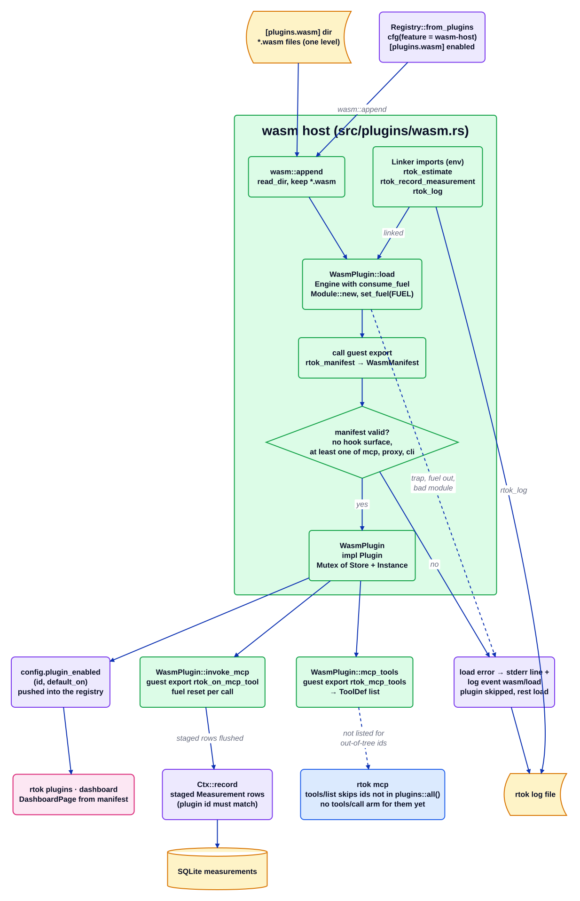

# Плагін wasm

Джерело: [`wasm.d2`](../../../architecture/plugins/wasm.d2). Документація плагіна: [`src/plugins/wasm.rs`](../../../../src/plugins/wasm.rs). Індекс: [усі діаграми](../README.md).

Хост WASM дає третій стороні змогу поставляти плагін як файл `.wasm` замість крейта Rust у цьому
репозиторії. Він компілюється лише з функцією Cargo `wasm-host` (на основі `wasmi`) і
завантажується лише тоді, коли `[plugins.wasm] enabled = true`. Це не плагін каталогу: його немає в
`plugins::all()` і немає власного маніфесту.

## Покроково

1. **Реєстр запитує сторонні плагіни.** `Registry::from_plugins` спершу будує нативний список
   через `config.plugin_enabled`, а потім (фіча `wasm-host`) викликає `wasm::append`. Він повертає
   список без змін, коли `[plugins.wasm] enabled` має значення false або каталог не можна прочитати.
2. **Завантажується кожен `*.wasm`-файл.** `append` сканує `[plugins.wasm] dir` (за замовчуванням
   `~/.rtok/plugins`, один рівень) і викликає `WasmPlugin::load`. Рушій створюється з
   `consume_fuel(true)`; `Module::new` перевіряє модуль.
3. **Гість отримує три імпорти.** `Linker` надає лише `env.rtok_estimate`,
   `env.rtok_record_measurement` і `env.rtok_log`. Вимірювання, чий `plugin` не є id самого гостя,
   перериває виклик; коректне лише ставиться в чергу, а записує його хост пізніше.
4. **Маніфест читається в межах бюджету.** `store.set_fuel(FUEL)` виконується перед
   `instantiate_and_start` і знову перед експортом гостя `rtok_manifest`, який повертає упакований
   вказівник і довжину JSON `WasmManifest` (`id`, `surfaces`, `default_on`, `title`, `summary`,
   `saves_tokens`). Читання пам'яті гостя проходить через `guest_slice`, який відхиляє від'ємний
   або поза межами вказівник замість аварійного завершення.
5. **Перевірка.** Маніфест, який перелічує поверхню `hook`, відхиляється, так само як і той, де
   немає жодної поверхні з `mcp`, `proxy` або `cli`. Будь-яка помилка завантаження записується в
   stderr і в журнал (`wasm` / `load`), і пропускається лише цей плагін.
6. **Реєстрація.** Коректний плагін стає `WasmPlugin` (`impl Plugin`, що тримає `Mutex<WasmInner>`)
   і додається через `config.plugin_enabled(id, default_on)`. Його `dashboard_page` береться з
   тексту маніфесту гостя.
7. **Інструменти MCP.** `mcp_tools` викликає експорт гостя `rtok_mcp_tools` і розбирає список
   `ToolDef` у JSON. `invoke_mcp` викликає `rtok_on_mcp_tool` із скиданням палива, переносить
   поставлені в чергу вимірювання до `Ctx::record` і повертає текст гостя. Наразі `invoke_mcp`
   викликають лише тести: `src/mcp.rs` пропускає інструменти id поза `plugins::all()` під час
   побудови `tools/list`, а `invoke` не має для них гілки.

## Де це живе

| Блок | Код |
| --- | --- |
| Registry::from_plugins | `src/plugins/mod.rs` (`Registry::from_plugins`) |
| wasm::append | `src/plugins/wasm.rs` (`append`) |
| WasmPlugin::load | `src/plugins/wasm.rs` (`WasmPlugin::load`, `load_with_fuel`, `FUEL`) |
| Імпорти Linker | `src/plugins/wasm.rs` (`rtok_estimate`, `rtok_record_measurement`, `rtok_log`) |
| Маніфест коректний? | `src/plugins/wasm.rs` (`WasmManifest`, перевірки поверхонь у `load_with_fuel`) |
| WasmPlugin | `src/plugins/wasm.rs` (`WasmPlugin`, `WasmInner`, `WasmHost`) |
| mcp_tools, invoke_mcp | `src/plugins/wasm.rs` (`mcp_tools`, `invoke_mcp`, `guest_bytes`) |
| Фільтр tools/list MCP | `src/mcp.rs` (перевірка `builtin` перед `p.mcp_tools()`) |
| Конфігурація | `crates/rtok-config/` (`[plugins.wasm]` `enabled`, `dir`) |
| Прапорець фічі | `Cargo.toml` (`wasm-host = ["dep:wasmi"]`) |
| Демо-гість | `crates/rtok-wasm-demo-guest/` |

## Інваріанти

- Відкрита відмова: зламаний `.wasm` записується в журнал і пропускається, ніколи не є фатальним
  для реєстру.
- Гість недовірений: кожен виклик виконується в межах бюджету палива (`FUEL`), тож нескінченний
  цикл перериває виконання замість того, щоб заклинити `rtok mcp` (тест `endless_guest_runs_out_of_fuel`);
  вказівники гостя перевіряються на межі (тест `guest_slice_rejects_what_used_to_panic`).
- Немає поверхні хука: плагін WASM не може оголосити `hook`, тож жоден сторонній код не сидить
  на шляху хука 10 мс.
- Гість не може записувати рядки для іншого id плагіна; рядки записує хост через `Ctx::record`,
  тож економія все одно потребує рядка `Measurement`.
- Вимкнено за замовчуванням: без фічі `wasmi` не лінкується, а за `enabled = false` нічого не читається.

## Пов'язане

[Огляд](../overview.md) · [Контракт плагіна](../plugin-contract.md) · [Crates](../crates.md)
